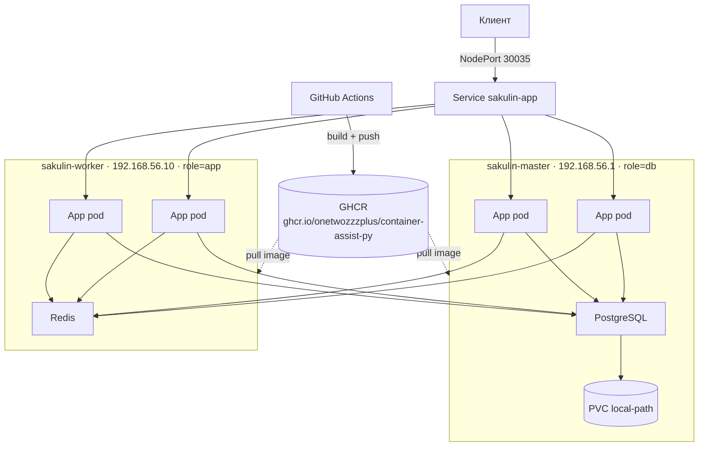

# 🎓 Personal Assistant — учебный проект для практики Docker и Kubernetes

[](https://github.com/OneTwoZzzPlus/container-assist-py/actions/workflows/ci.yml)

> [Ход работы](./lab6/README.MD) | [список всех лаб](https://github.com/OneTwoZzzPlus/container-assist-py)

Простое FastAPI-приложение с PostgreSQL и Redis. Развёртывается в кластере k3s из двух узлов (master и worker). Образ приложения автоматически собирает и публикует в GHCR GitHub Actions, а выкатка новой версии выполняется через rolling update.

## Структура проекта

```text
.
├── .github/
│   └── workflows/
│       └── ci.yml               # CI: проверка кода, сборка и публикация образа в GHCR
├── app/
│   ├── __init__.py
│   ├── main.py                  # FastAPI, маршруты и Redis-кэширование
│   ├── database.py              # Подключение к PostgreSQL
│   ├── models.py                # Модель Note (SQLAlchemy)
│   └── crud.py                  # CRUD-операции для заметок
├── config/
│   └── app.conf                 # Конфигурация приложения
├── k8s/
│   ├── postgres-pvc.yaml        # Постоянное хранилище PostgreSQL
│   ├── postgres-deployment.yaml # Deployment PostgreSQL (закреплён за master)
│   ├── postgres-service.yaml    # Внутренний Service PostgreSQL
│   ├── redis-deployment.yaml    # Deployment Redis
│   ├── redis-service.yaml       # Внутренний Service Redis
│   ├── app-configmap.yaml       # Несекретные настройки приложения
│   ├── app-secret.example.yaml  # Шаблон Secret с учебными значениями
│   ├── app-deployment.yaml      # Deployment FastAPI: 4 реплики, probes, распределение по узлам
│   ├── app-service.yaml         # NodePort Service (порт 30035)
│   └── app-ingress.yaml         # Ingress (необязательно, бонус)
├── Dockerfile                   # Сборка образа FastAPI-приложения
├── requirements.txt             # Python-зависимости
├── .gitignore                   # Исключения Git, в том числе настоящий app-secret.yaml
└── README.md
```

## CI/CD и кластер

### Узлы кластера и их роли

| Узел             | IP              | Роль          | Метка      | Что запускается                                    |
| ---------------- | --------------- | ------------- | ---------- | -------------------------------------------------- |
| `sakulin-master` | `192.168.56.1`  | control plane | `role=db`  | PostgreSQL (через `nodeSelector`), поды приложения |
| `sakulin-worker` | `192.168.56.10` | worker        | `role=app` | Redis, поды приложения                             |

- PostgreSQL закреплён за master, потому что его PersistentVolumeClaim использует storage-класс `local-path`: данные лежат на диске конкретного узла.
- Поды приложения (4 реплики) распределяются по обоим узлам через `topologySpreadConstraints` (`maxSkew: 1`, `topologyKey: kubernetes.io/hostname`). `nodeSelector` для приложения не используется.
- NodePort `30035` открыт на каждом узле: приложение доступно и по IP master, и по IP worker.



### Как работает CI

Workflow `.github/workflows/ci.yml` запускается при push в ветки `main` и `lab-6`, а также вручную (`workflow_dispatch`):

1. **test** — устанавливает зависимости и проверяет синтаксис (`python -m compileall app`).
2. **build-and-push** — запускается только после успешного `test`, собирает образ для `linux/amd64` и `linux/arm64` и публикует его в GHCR с тегами `sha-<короткий_sha>` и `latest`.

В манифестах используется только тег с SHA: он однозначно указывает на версию кода, позволяет откатываться и запускает rolling update. Тег `latest` для развёртывания не применяется.

### Как выкатить новую версию

1. Внести изменения в код, сделать commit и push в ветку `lab-6`.
2. Дождаться зелёного пайплайна в Actions и скопировать новый тег `sha-<...>`.
3. Обновить образ в кластере:

    ```bash
    kubectl set image deployment/sakulin-app app=ghcr.io/onetwozzzplus/container-assist-py:sha-<новый_sha>
    kubectl rollout status deployment/sakulin-app
    kubectl get pods -o wide
    curl http://192.168.56.1:30035/ ;echo
    ```

4. Зафиксировать версию в Git отдельным коммитом, чтобы манифест соответствовал кластеру:

    ```bash
    # в k8s/app-deployment.yaml заменить тег в image: на sha-<новый_sha>
    git add k8s/app-deployment.yaml
    git commit -m "lab6: bump app image to sha-<новый_sha>"
    git push origin lab-6

    kubectl apply -f k8s/
    kubectl diff -f k8s/        # пустой вывод: Git и кластер совпадают
    ```

### Как откатить версию

```bash
kubectl rollout history deployment/sakulin-app            # список ревизий
kubectl rollout undo deployment/sakulin-app               # откат на предыдущую ревизию
kubectl rollout undo deployment/sakulin-app --to-revision=<N>   # откат на конкретную ревизию
kubectl rollout status deployment/sakulin-app
```

`rollout undo` меняет только состояние кластера. Чтобы манифест в Git снова соответствовал кластеру, верните прежний тег в `k8s/app-deployment.yaml` (например, через `git revert` коммита с обновлением тега) и выполните `kubectl apply -f k8s/`.

### Отказоустойчивость

Если на worker остановить агент (`sudo systemctl stop k3s-agent`), через 1–2 минуты узел становится `NotReady`, но поды на нём ещё отображаются как `Running`: Kubernetes ждёт 300 секунд, прежде чем выселять поды. Через 5+ минут поды выселяются, а контроллеры создают их замены. Вернуть узел в работу можно командой `sudo systemctl start k3s-agent`; чтобы заново распределить поды по обоим узлам, выполните `kubectl rollout restart deployment/sakulin-app`.

## Kubernetes

### Предварительные требования

- Два Linux-узла в одной сети (кабель, Wi-Fi или ВМ в режиме Bridged / host-only с доступом друг к другу), от 2 vCPU и 2 ГБ памяти на узел;
- свободное место на диске master: при заполнении диска kubelet выставляет `DiskPressure` и выселяет поды;
- открытые между узлами порты: `6443/tcp`, `8472/udp`, `10250/tcp`, `30000-32767/tcp`;
- `kubectl` и `sudo`.

### 1. Поднять кластер k3s

На master:

```bash
curl -sfL https://get.k3s.io | INSTALL_K3S_EXEC="server --node-name sakulin-master --node-ip <IP_master> --tls-san <IP_master>" sh -
sudo cat /var/lib/rancher/k3s/server/node-token   # токен для worker (в репозиторий не добавлять)
```

На worker:

```bash
curl -sfL https://get.k3s.io | K3S_URL=https://<IP_master>:6443 K3S_TOKEN=<токен> INSTALL_K3S_EXEC="agent --node-name sakulin-worker --node-ip <IP_worker>" sh -
```

Проверка на master и метки узлов:

```bash
mkdir -p ~/.kube && sudo cp /etc/rancher/k3s/k3s.yaml ~/.kube/config && sudo chown $USER ~/.kube/config
kubectl get nodes -o wide

kubectl label node sakulin-master role=db
kubectl label node sakulin-worker role=app
kubectl get nodes --show-labels
```

Оба узла должны быть `Ready` и иметь разные `INTERNAL-IP`.

### 2. Образ приложения

Образ собирается в GitHub Actions и публикуется в GHCR, локально собирать и загружать его в кластер не нужно. Пакет должен быть публичным (GitHub → Packages → Package settings → Change visibility → Public), чтобы узлы скачивали образ без авторизации:

```bash
docker pull ghcr.io/onetwozzzplus/container-assist-py:sha-<короткий_sha>
```

Тег образа указан в `k8s/app-deployment.yaml` в поле `spec.template.spec.containers[].image`.

### 3. Подготовить Secret

Создайте локальный файл на основе шаблона:

```bash
cp k8s/app-secret.example.yaml k8s/app-secret.yaml
```

Откройте `k8s/app-secret.yaml` и укажите собственные учебные значения как минимум для `APP_SECRET` и `POSTGRES_PASSWORD`. Настоящий `app-secret.yaml` в Git не добавляется.

### 4. Применить манифесты

```bash
kubectl apply -f k8s/
```

### 5. Проверить запуск

```bash
kubectl get all
kubectl get pods -o wide
```

В колонке `NODE` поды приложения должны быть и на master, и на worker, PostgreSQL — на master. Логи приложения:

```bash
kubectl logs deployment/sakulin-app
```

### 6. Проверить API

NodePort открыт на каждом узле, поэтому приложение отвечает по IP любого из них:

```bash
curl http://192.168.56.1:30035/ ;echo
curl http://192.168.56.10:30035/ ;echo
curl http://192.168.56.1:30035/health ;echo

curl http://192.168.56.1:30035/weather/Moscow ;echo
curl http://192.168.56.10:30035/weather/Moscow ;echo
curl http://192.168.56.1:30035/cache/stats ;echo

curl -X POST http://192.168.56.1:30035/notes \
  -H "Content-Type: application/json" \
  -d '{"text":"ЛР6: кластер из двух узлов"}' ;echo

curl http://192.168.56.10:30035/notes ;echo
```

Балансировка между подами:

```bash
for i in $(seq 1 10); do curl -s http://192.168.56.10:30035/ | python3 -c "import sys,json; print(json.load(sys.stdin).get('hostname'))"; done
```

Ожидаемые результаты:

- `GET /` возвращает приветствие, `hostname` и `server_time`; в выводе цикла встречаются разные имена подов;
- `GET /health` показывает корректное состояние подключения к PostgreSQL и Redis;
- первый запрос `GET /weather/{city}` возвращает `"source": "api"`, повторный (в том числе через другой узел) — `"source": "cache"`;
- `POST /notes` создаёт заметку, а `GET /notes` читает её через другой узел.

### 7. Проверить readiness и liveness probes

```bash
kubectl describe pod <имя-пода-приложения>
kubectl get pods
```

В выводе `describe` должны присутствовать `Readiness` и `Liveness` (`GET /health` на порту `8035`), а в Conditions — `Ready: True`.

### 8. Ingress (необязательно)

В k3s по умолчанию установлен Traefik, поэтому дополнительных аддонов включать не нужно:

```bash
kubectl apply -f k8s/app-ingress.yaml
kubectl get ingress
```

Для обращения по имени `sakulin.local` добавьте IP master в файл hosts вашей операционной системы:

```bash
echo "192.168.56.1 sakulin.local" | sudo tee -a /etc/hosts
```

## Полезные команды Kubernetes

```bash
# Список ресурсов, поды и узлы
kubectl get all
kubectl get pods -o wide
kubectl get nodes -o wide
kubectl get svc
kubectl get pvc

# Подробная информация
kubectl describe pod <pod-name>
kubectl describe node sakulin-master

# Логи приложения и зависимостей
kubectl logs deployment/sakulin-app
kubectl logs deployment/sakulin-postgres
kubectl logs deployment/sakulin-redis
kubectl logs -f deployment/sakulin-app

# События кластера
kubectl get events --sort-by=.metadata.creationTimestamp

# Перезапуск и статус выкатки
kubectl rollout restart deployment/sakulin-app
kubectl rollout status deployment/sakulin-app
kubectl rollout history deployment/sakulin-app

# Удалить «мусорные» поды после выселения
kubectl delete pods --field-selector=status.phase=Failed
kubectl delete pods --field-selector=status.phase=Succeeded
```

## Остановка и удаление ресурсов

Удалить созданные Kubernetes-ресурсы:

```bash
kubectl delete -f k8s/
```

Остановить k3s на узле (на worker — `k3s-agent`, на master — `k3s`):

```bash
sudo systemctl stop k3s-agent
sudo systemctl stop k3s
```

## Архитектура

Kubernetes управляет запуском контейнеров через Deployments. Внутренние Service предоставляют постоянные адреса для связи приложения с PostgreSQL и Redis, а NodePort Service открывает приложение на каждом узле кластера. Данные PostgreSQL сохраняются в PersistentVolume (`local-path`), запрошенном через PersistentVolumeClaim, поэтому база закреплена за узлом master.

## Эндпоинты API

| Метод  | URL               | Описание                                                         |
| ------ | ----------------- | ---------------------------------------------------------------- |
| GET    | `/`               | Приветствие, информация о приложении, `hostname` и `server_time` |
| GET    | `/health`         | Проверка состояния приложения, PostgreSQL и Redis                |
| GET    | `/docs`           | Swagger UI — интерактивная документация API                      |
| GET    | `/me`             | Информация о владельце приложения                                |
| GET    | `/secret/{key}`   | Проверка секретного ключа                                        |
| GET    | `/weather/{city}` | Погода с Redis-кэшированием                                      |
| GET    | `/cache/stats`    | Статистика кэша текущего владельца                               |
| POST   | `/notes`          | Создать заметку; тело: `{"text": "..."}`                         |
| GET    | `/notes`          | Получить все заметки                                             |
| GET    | `/notes/{id}`     | Получить заметку по ID                                           |
| DELETE | `/notes/{id}`     | Удалить заметку по ID                                            |

## Переменные окружения

Несекретные настройки хранятся в `ConfigMap`, чувствительные данные — в `Secret`. Имена ключей в манифестах должны совпадать с теми, которые читает приложение.

| Переменная          | Назначение                                     | Где задаётся |
| ------------------- | ---------------------------------------------- | ------------ |
| `APP_OWNER`         | Персональное имя владельца приложения          | ConfigMap    |
| `APP_PORT`          | Порт приложения внутри пода (`8035`)           | ConfigMap    |
| `APP_SECRET`        | Секретный ключ для `/secret/{key}`             | Secret       |
| `POSTGRES_USER`     | Пользователь PostgreSQL                        | ConfigMap    |
| `POSTGRES_PASSWORD` | Пароль PostgreSQL                              | Secret       |
| `POSTGRES_DB`       | Имя базы данных                                | ConfigMap    |
| `POSTGRES_HOST`     | Адрес PostgreSQL внутри кластера (имя Service) | ConfigMap    |
| `POSTGRES_PORT`     | Порт PostgreSQL                                | ConfigMap    |
| `REDIS_URL`         | Адрес Redis внутри кластера (имя Service)      | ConfigMap    |
| `REDIS_PORT`        | Порт Redis                                     | ConfigMap    |
| `CACHE_TTL`         | Время жизни кэша в секундах                    | ConfigMap    |

## Что проверить перед демонстрацией

- [ ] Оба узла `Ready` с разными `INTERNAL-IP` (`kubectl get nodes -o wide`), на master нет `DiskPressure`.
- [ ] Оба job в GitHub Actions зелёные, бейдж CI в начале README отображается.
- [ ] Образ в GHCR публичный, в `app-deployment.yaml` указан тег `sha-<...>`, а не `latest`.
- [ ] Поды приложения (4 реплики) `Running` и распределены по обоим узлам, PostgreSQL — на master.
- [ ] `kubectl get pvc` показывает, что хранилище PostgreSQL привязано (`Bound`).
- [ ] `GET /health` подтверждает доступность PostgreSQL и Redis; приложение отвечает по IP обоих узлов на NodePort `30035`.
- [ ] В ответах API поле `hostname` содержит разные имена подов Kubernetes.
- [ ] Первый запрос погоды возвращает `"source": "api"`, повторный — `"source": "cache"`; заметка, созданная через один узел, читается через другой.
- [ ] `APP_OWNER` содержит персональное имя владельца из ConfigMap.
- [ ] Rolling update выполнен (`rollout status`), ответ приложения изменился; откат (`rollout undo`) работает.
- [ ] Тег в `k8s/app-deployment.yaml` совпадает с образом в кластере (`kubectl diff -f k8s/` пуст).
- [ ] Настоящий `k8s/app-secret.yaml`, токены и `node-token` не попали в Git.
