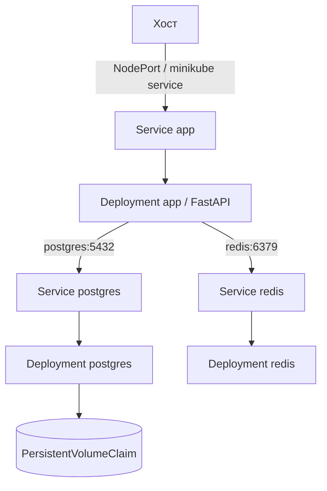

# 🎓 Personal Assistant — учебный проект для практики Docker

> [Ход работы](./lab5/README.MD) | [список всех лаб](https://github.com/OneTwoZzzPlus/container-assist-py)

Простое FastAPI-приложение с PostgreSQL и Redis. Для развёртывания используется локальный кластер Kubernetes: приложение, база данных и кэш запускаются в отдельных Pod, а для их взаимодействия применяются Service и стандартные ресурсы Kubernetes.

## Структура проекта

```text
.
├── app/
│   ├── __init__.py
│   ├── main.py                  # FastAPI, маршруты и Redis-кэширование
│   ├── database.py              # Подключение к PostgreSQL
│   ├── models.py                # Модель Note (SQLAlchemy)
│   └── crud.py                  # CRUD-операции для заметок
├── config/
│   └── app.conf                 # Конфигурация приложения
├── k8s/
│   ├── postgres-pvc.yaml        # Постоянное хранилище PostgreSQL
│   ├── postgres-deployment.yaml # Deployment PostgreSQL
│   ├── postgres-service.yaml    # Внутренний Service PostgreSQL
│   ├── redis-deployment.yaml    # Deployment Redis
│   ├── redis-service.yaml       # Внутренний Service Redis
│   ├── app-configmap.yaml       # Несекретные настройки приложения
│   ├── app-secret.example.yaml  # Шаблон Secret с учебными значениями
│   ├── app-deployment.yaml      # Deployment FastAPI с readiness/liveness probes
│   ├── app-service.yaml         # Service для доступа к приложению
│   └── app-ingress.yaml         # Ingress (необязательно, бонус)
├── Dockerfile                  # Сборка образа FastAPI-приложения
├── requirements.txt            # Python-зависимости
├── .gitignore                  # Исключения Git, в том числе настоящий app-secret.yaml
└── README.md
```

## Kubernetes

### Предварительные требования

Установите:

- Docker;
- `kubectl`;
- Minikube.

> Для локального кластера рекомендуется выделить не менее 2 CPU и 4 ГБ памяти.

### 1. Запустить кластер

Для Minikube:

```bash
minikube start --cpus=2 --memory=4096
kubectl cluster-info
kubectl get nodes
```

Убедитесь, что узел кластера находится в состоянии `Ready`.

### 2. Собрать образ приложения и передать его в кластер

Соберите образ из `Dockerfile`:

```bash
docker build -t sakulin-assistant:final .
```

Для локального Minikube загрузите собранный образ в кластер:

```bash
minikube image load sakulin-assistant:final
minikube image ls | grep sakulin-assistant
```

> В `k8s/app-deployment.yaml` этот образ указан в поле `spec.template.spec.containers[].image`.

### 3. Подготовить Secret

Создайте локальный файл на основе шаблона:

```bash
cp k8s/app-secret.example.yaml k8s/app-secret.yaml
```

Откройте `k8s/app-secret.yaml` и укажите собственные значения как минимум для `APP_SECRET` и `POSTGRES_PASSWORD`.

### 4. Применить манифесты

```bash
kubectl apply -f k8s/
```

### 5. Проверить запуск

Посмотрите, какие ресурсы созданы:

```bash
kubectl get all
```

Проверить логи приложения:

```bash
kubectl logs pod/sakulin-app-<...>
```

### 6. Открыть приложение и проверить API

Для Service типа `NodePort` откройте приложение через Minikube:

```bash
minikube service sakulin-app-service
```

Команда выведет адрес приложения. Используйте его вместо `<APP_URL>` в запросах:

```bash
curl <APP_URL>/ ;echo
curl <APP_URL>/health ;echo

curl <APP_URL>/weather/Moscow ;echo
curl <APP_URL>/weather/Moscow ;echo
curl <APP_URL>/cache/stats ;echo

curl -X POST <APP_URL>/notes \
  -H "Content-Type: application/json" \
  -d '{"text":"Моя первая заметка"}' ;echo

curl <APP_URL>/notes ;echo
```

Ожидаемые результаты:

- `GET /` возвращает приветствие, `hostname` и `server_time`;
- `GET /health` показывает корректное состояние подключения к PostgreSQL и Redis;
- первый запрос `GET /weather/{city}` получает данные из Open-Meteo и возвращает `"source": "api"`;
- повторный запрос того же города возвращает данные из Redis и `"source": "cache"`;
- `POST /notes` создаёт заметку, а `GET /notes` возвращает сохранённые заметки.

### 7. Проверить readiness и liveness probes

Проверьте настройки и состояние Pod:

```bash
kubectl describe pod sakulin-app
kubectl get pods
```

В выводе `describe` должны присутствовать `Readiness` и `Liveness`, а у работающего Pod в Conditions должно быть `Ready: True`.

### 8. Ingress

Ingress — дополнительная настройка. Для Minikube включите аддон:

```bash
minikube addons enable ingress
kubectl apply -f k8s/app-ingress.yaml
kubectl get ingress
```

Для обращения по локальному имени настройте разрешение `sakulin.local` на IP Minikube в файле hosts вашей операционной системы.

```bash
sudo sed -i '/sakulin.local/d' /etc/hosts && echo "$(minikube ip) sakulin.local" | sudo tee -a /etc/hosts > /dev/null
```

## Полезные команды Kubernetes

```bash
# Список ресурсов и Pod
kubectl get all
kubectl get pods -o wide
kubectl get svc
kubectl get pvc

# Подробная информация о Pod
kubectl describe pod <pod-name>

# Логи приложения и зависимостей
kubectl logs deployment/app
kubectl logs deployment/postgres
kubectl logs deployment/redis

# Следить за логами приложения
kubectl logs -f deployment/app

# Посмотреть события кластера
kubectl get events --sort-by=.metadata.creationTimestamp

# Перезапустить Deployment приложения после изменения конфигурации
kubectl rollout restart deployment/app
kubectl rollout status deployment/app
```

## Остановка и удаление ресурсов

Остановить локальный кластер, сохранив его состояние:

```bash
minikube stop
```

Удалить созданные Kubernetes-ресурсы:

```bash
kubectl delete -f k8s/
```

## Архитектура

Kubernetes заменяет Docker Compose и управляет запуском контейнеров через Deployments. Внутренние Service предоставляют постоянные адреса для связи приложения с PostgreSQL и Redis. Данные PostgreSQL сохраняются в PersistentVolume, запрошенном через PersistentVolumeClaim.



## Эндпоинты API

| Метод  | URL               | Описание                                                         |
| ------ | ----------------- | ---------------------------------------------------------------- |
| GET    | `/`               | Приветствие, информация о приложении, `hostname` и `server_time` |
| GET    | `/health`         | Проверка состояния приложения, PostgreSQL и Redis                |
| GET    | `/docs`           | Swagger UI — интерактивная документация API                      |
| GET    | `/me`             | Информация о владельце приложения                                |
| GET    | `/secret/{key}`   | Проверка секретного ключа                                        |
| GET    | `/weather/{city}` | Погода с Redis-кэшированием                                      |
| GET    | `/cache/stats`    | Статистика кэша текущего владельца                               |
| POST   | `/notes`          | Создать заметку; тело: `{"text": "..."}`                         |
| GET    | `/notes`          | Получить все заметки                                             |
| GET    | `/notes/{id}`     | Получить заметку по ID                                           |
| DELETE | `/notes/{id}`     | Удалить заметку по ID                                            |

## Переменные окружения

Несекретные настройки хранятся в `ConfigMap`, чувствительные данные — в `Secret`. Имена ключей в манифестах должны совпадать с теми, которые читает приложение.

| Переменная          | Назначение                                                    | Где задаётся                                            |
| ------------------- | ------------------------------------------------------------- | ------------------------------------------------------- |
| `APP_OWNER`         | Персональное имя владельца приложения                         | ConfigMap                                               |
| `APP_SECRET`        | Секретный ключ для `/secret/{key}`                            | Secret                                                  |
| `POSTGRES_USER`     | Пользователь PostgreSQL                                       | ConfigMap / Secret — согласно принятой схеме манифестов |
| `POSTGRES_PASSWORD` | Пароль PostgreSQL                                             | Secret                                                  |
| `POSTGRES_DB`       | Имя базы данных                                               | ConfigMap                                               |
| `REDIS_URL`         | Адрес Redis внутри кластера; например, `redis://redis:6379/0` | ConfigMap                                               |
| `CACHE_TTL`         | Время жизни кэша в секундах                                   | ConfigMap                                               |

## Что проверить перед демонстрацией

- [ ] Все Pod находятся в состоянии `Running`, приложение имеет статус `Ready`.
- [ ] `kubectl get pvc` показывает, что хранилище PostgreSQL привязано (`Bound`).
- [ ] `GET /health` подтверждает доступность PostgreSQL и Redis.
- [ ] Первый запрос погоды возвращает `"source": "api"`, повторный — `"source": "cache"`.
- [ ] В ответах API поле `hostname` содержит имя Pod Kubernetes.
- [ ] `APP_OWNER` содержит персональное имя владельца из ConfigMap.
- [ ] В `kubectl describe pod` видны `readinessProbe` и `livenessProbe`, состояние Pod — `Ready: True`.
- [ ] Настоящий `k8s/app-secret.yaml` не попал в Git.
