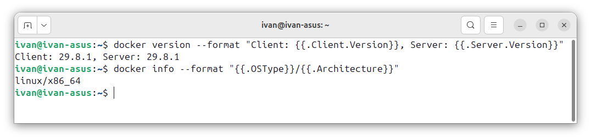
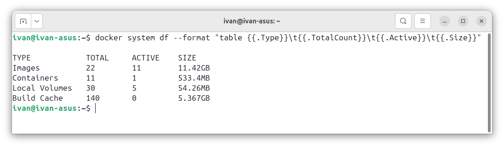
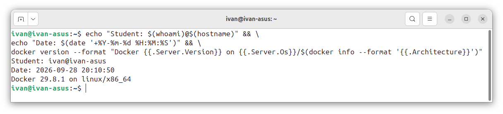
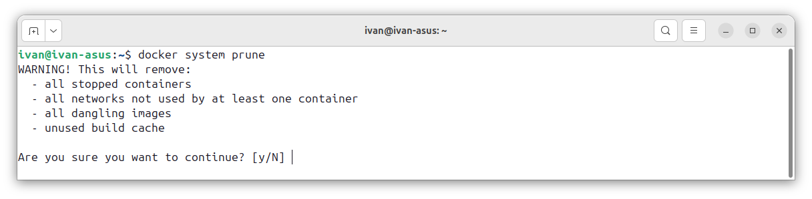
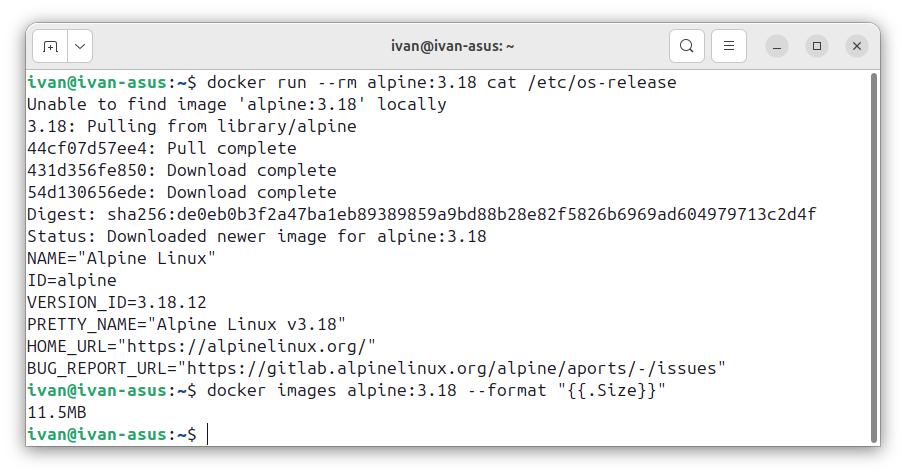
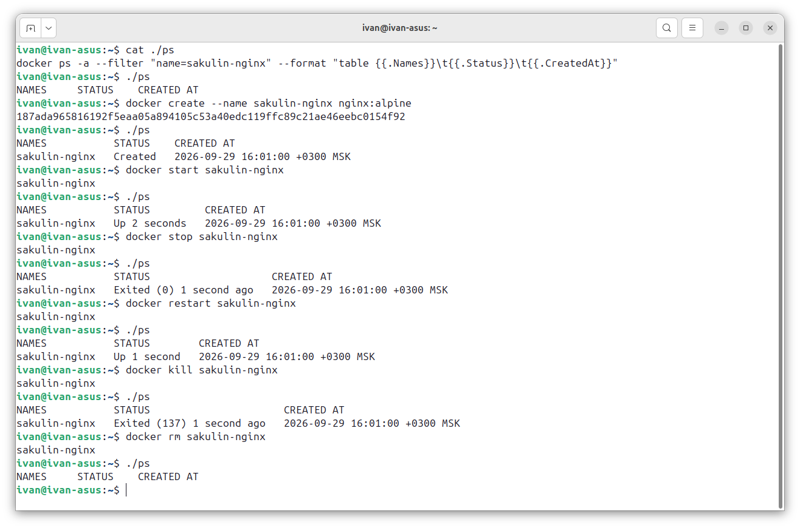
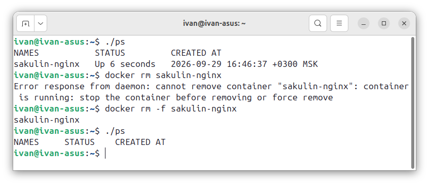
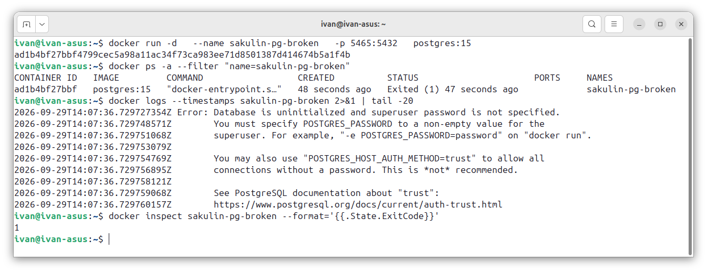
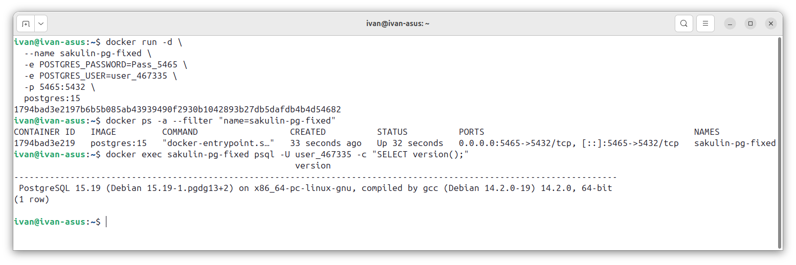

# Практическая работа №1. Знакомство с экосистемой Docker: от базовых команд к диагностике сервиса

## Введение

| Параметр             | Как определить                      | Ваше значение |
| -------------------- | ----------------------------------- | ------------- |
| Номер ИСУ            | Можно взять из ЛК                   | 467335        |
| Персональный порт    | 5430 + последние 2 цифры ису        | 5465          |
| Персональный префикс | Фамилия латиницей в нижнем регистре | sakulin       |

## Этап 1. Верификация окружения и архитектуры

### Задание 1.1 — Проверка установки Docker

На рисунке (1-1) представлен результат выполнения проверки. Командой `version` доказана установка Docker и определены версии клиента и сервера `29.8.1`. Командой `info` определена архитектура системы `info`, на которой Docker запущен.

### Задание 1.2 — Cостояние локального хранилища

На рисунке (1-2) таблица, содержащая общую информацию о локальных образах, контейнерах, хранилищах и кеше. До начала работы в системе хранится 22 образа и запущен один контейнер.

### Задание 1.3 — Артефакт окружения

На рисунке (1-3) представлен артефакт окружения: рабочее имя пользователя, имя машины, версия docker и тип операционной системы.

При запуске команды из задания возникала ошибка: `{{.Server.Architecture}}` поля не существует, после обновления Docker ошибка не исчезла. Заменил её в итоговой команде на `$(docker info --format '{{.Architecture}}')`, предыдущую команду, которая подставила архитектуру машины.

### Вопросы (1)

1. При запуске `docker system prune` без флагов система предложит подтвердить действие и отобразит все удаляемые объекты (1-q). Если не соглашаться, то данные не будут утеряны, однако, если согласиться, то удалятся все остановленные контейнеры, неиспользуемые сети, кеш и образы без тегов.
   

2. Docker CLI обращается к Docker daemon для управления. Если первый не сможет достучаться до второго, то команда `version` завершиться с ошибкой. Причиной может стать, например, неработающий daemon (рисунок 1-e) или несовместимость версий клиента и сервера.
   

## Этап 2. Первые шаги: «игрушечные» образы

### Задание 2.1 — Запуск классического примера

На рисунке (2-1) показан запуск `hello-world`, выведены имя репозитория и тег (`docker.io/library/hello-world:latest`) и имя исполняемого файла внутри (`/hello`).

### Задание 2.2 — Минимальный образ

На рисунке (2-2) представлен запуск `alpine`, прочитан файл именования системы (`PRETTY_NAME="Alpine Linux v3.18"`), выведен размер образа (`11.5MB`).

### Задание 2.3 — Сравнение поведения двух контейнеров

На рисунке (2-3) запуск двух `alpine` и проверка их статуса: оба контейнера работали 5 минут. Второй контейнер также вывел в логи сообщение.

### Вопросы (2)

1. Главный процесс запускается с PID 1, пока этот процесс работает, контейнер не завершается. У hello-world процесс просто выводит сообщение, у alpine процесс выполняется 5 минут.
2. Если убрать флаг `--rm`, то после завершения контейнер останется в неактивных. Все контейнеры можно посмотреть через `docker ps -a`, удалить ненужные через `docker rm`. Альтернативно, можно удалить все остановленные контейнеры через `docker container prune`.

## Этап 3. Жизненный цикл контейнера

На рисунке (3-1) представлены разные жизненные этапы контейнера: создание, запуск, перезапуск, два вида остановки, удаление. По умолчанию, `docker stop` отправляет 15 сигнал `SIGTERM`, однако если контейнер не завершил работу за `grace period`, то отправляет уже 9 сигнал `SIGKILL`. В отличие от него `docker kill` сразу отправляет 9 сигнал `SIGKILL`, из-за этого в БД могут не сохраниться последние выполняемые транзакции.

## Вопросы (3)

1. Что произойдет, если выполнить docker rm для запущенного контейнера? Какой флаг нужен для принудительного удаления?

При попытке удалить запущенный контейнер daemon докера вернет ошибку, принудительно удалить можно с флагом `-f` (рисунок (3-q)).

## Этап 4. Диагностика реального сервиса

### Задание 4.1 — Запуск с ошибкой

На рисунке (4-1) представлен запуск postgres с ошибкой, командами диагностики было подтверждено, что ошибка заключается в незаданном пароле.

### Задание 4.2 — Исправление и проверка

На рисунке (4-2) представлен успешный запуск postgres: контейнер работает, СУБД отвечает на запросы.

### Задание 4.3 — Финальный “артефакт”

На рисунке (4-3) показан финальный артефакт.
