# Практическая работа №2. Знакомство с экосистемой Docker: от базовых команд к диагностике сервиса

## Введение

| Параметр             | Ваше значение   |
| -------------------- | --------------- |
| Номер ИСУ            | 467335          |
| Персональный порт    | 5465            |
| Персональный префикс | sakulin         |
| Секретный ключ       | secret35sakulin |

## Этап 1. Первый рабочий образ

Был создан форк репозитория `FilBTi/assist-py` и склонирован на локальную машину (рисунок 1-0).

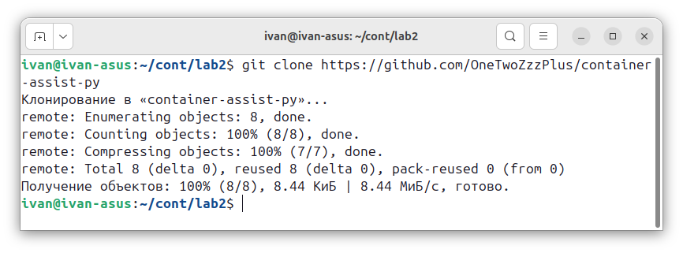

### Задание 1.1 — Базовый Dockerfile

На рисунке (1-code) представлен написанный базовый Dockerfile. В директорию `/app` контейнера копируем файл зависимостей, устанавливаем их, копируем код приложения, запускаем `uvicorn`.

```Dockerfile
FROM python:3.11-slim

LABEL maintainer="sakulin@lab.local"
LABEL version="1.0"

WORKDIR /app

COPY requirements.txt .

RUN pip install --no-cache-dir -r requirements.txt

COPY app/ ./app/

EXPOSE 5465

CMD ["uvicorn", "app.main:app", "--host", "0.0.0.0", "--port", "5465"]
```

### Задание 1.2 — Сборка образа

На рисунке (1-2) представлена успешная сборка образа первой версии.

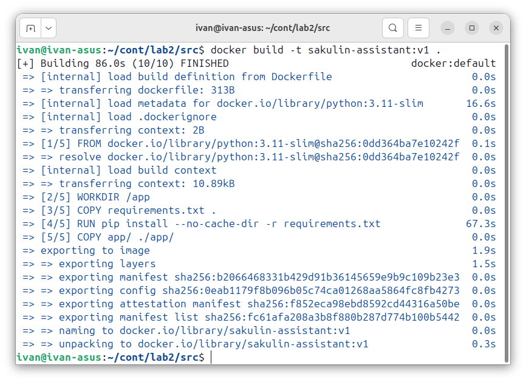

### Задание 1.3 — Запуск контейнера

На рисунке (1-3) запуск контейнера из образа `sakulin-assistant:v1`. Контейнер запущен и работает.

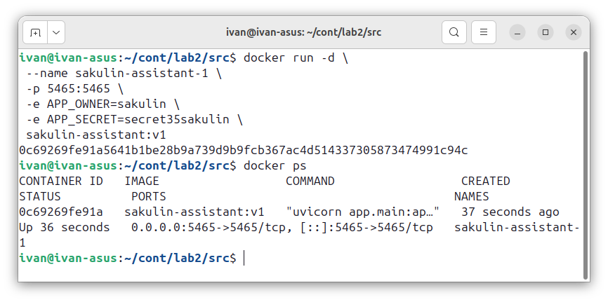

### Задание 1.4 — Проверка работоспособности

На рисунке (1-4) представлена проверка работоспособности приложения. Приложение отвечает, хозяин отображается корректно, записка добавляется и возвращается, секретный ключ совпадает.

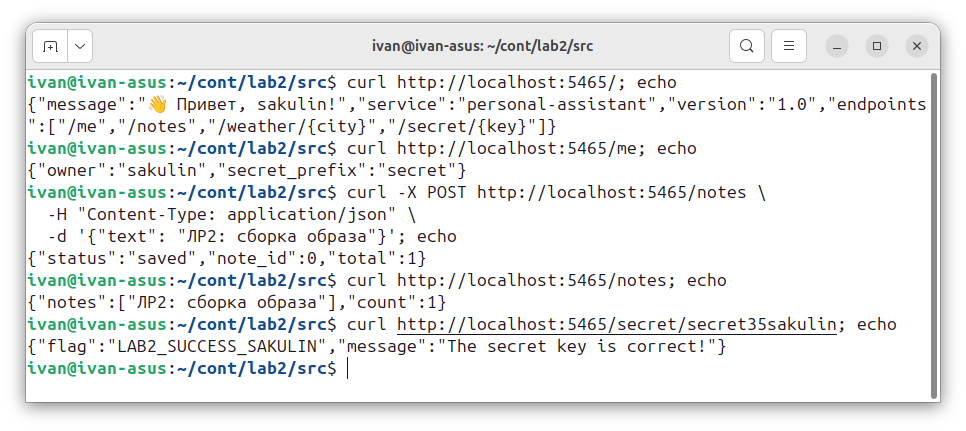

## Этап 2. Оптимизация образа

### Задание 2.1 — Оптимизированный Dockerfile

На рисунке (2-code) представлен оптимизированный Dockerfile. Установка зависимостей отдельными слоями уже была написана, в новой версии добавился multi-stage: на первой стадии в `builder` устанавливаем необходимые библиотеки в отдельную папку, на второй стадии вместе с кодом копируем установленные библиотеки в `/usr/local`.

```Dockerfile
FROM python:3.11-slim AS builder

WORKDIR /app
COPY requirements.txt .
RUN pip install --no-cache-dir --prefix=/sakulin -r requirements.txt

FROM python:3.11-slim AS runner

LABEL maintainer="sakulin@lab.local"
LABEL version="2.0"

WORKDIR /app
COPY --from=builder /sakulin /usr/local
COPY app/ ./app/
EXPOSE 5465

CMD ["uvicorn", "app.main:app", "--host", "0.0.0.0", "--port", "5465"]
```

Работоспособность приложения была проверена, успешный результат на рисунке (2-1).

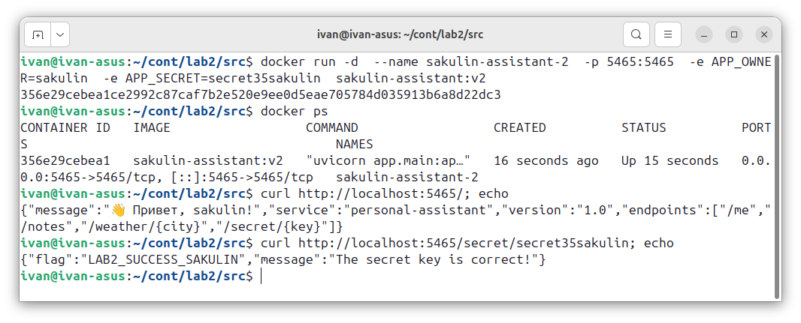

### Задание 2.2 — Сравнение образов

На рисунке (2-2) представлено сравнение образов первой и второй версий. Образ уменьшился на 17МБ (примерно 6.6%).
При раздельной работе с кодом и `requirements` скорость сборки возрастает, когда меняется только бизнес-логика (код), потому что Docker использует уже собранные слои с установкой библиотек из кеша и пересобирает только верхние слои с кодом.

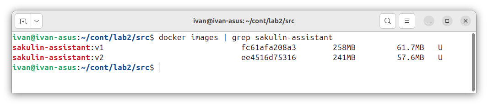

## Этап 3. Чистота в образе через `.dockerignore`

### Задание 3.1 — Создание `.dockerignore`

Был создан файл `.dockerignore`, его содержимое на рисунке (3-1).


### Задание 3.2 — Пересборка образа

Образ был собран, проверена его работоспособность (рисунок 3-2). Изменений не произошло, так как при копировании только `/app` и `requirements.txt` никакие лишние файлы не были помещены в образ ранее. Для директорию `.git` (и, например, `.env`) опасно попадание в образ, так как в них могли храниться секреты, конфигурации и старые версии файлов из истории коммитов.

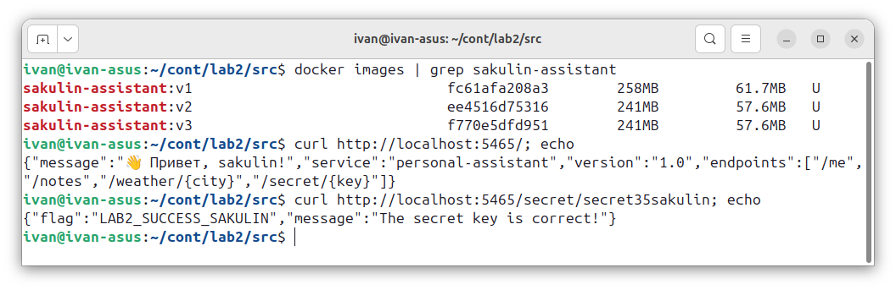

## Этап 4. Healthcheck — готовность к оркестрации

### Задание 4.1 — Добавление проверки здоровья

Был создан Dockerfile.final с добавленной строкой проверки здоровья (рисунок 4-code).

```Dockerfile
FROM python:3.11-slim AS builder

WORKDIR /app
COPY requirements.txt .
RUN pip install --no-cache-dir --prefix=/sakulin -r requirements.txt

FROM python:3.11-slim AS runner

LABEL maintainer="sakulin@lab.local"
LABEL version="2.0"

WORKDIR /app
COPY --from=builder /sakulin /usr/local
COPY app/ ./app/
EXPOSE 5465

HEALTHCHECK --interval=30s --timeout=5s --start-period=10s --retries=3 \
    CMD python -c "from urllib.request import urlopen; urlopen('http://localhost:5465/health')" || exit 1

CMD ["uvicorn", "app.main:app", "--host", "0.0.0.0", "--port", "5465"]
```

На первом запуске возникла ошибка: утилиты `curl` нет в стандартном образе python. У этой проблемы два решения: установить её или воспользоваться возможностями Python. Основываясь на безопасности, был выбран второй вариант, так как он не требует установки дополнительной утилиты, а значит, и потенциального увеличения поверхности атаки.

### Задание 4.2 — Сборка финальной версии

На рисунке (4-2) представлена успешная сборка образа.

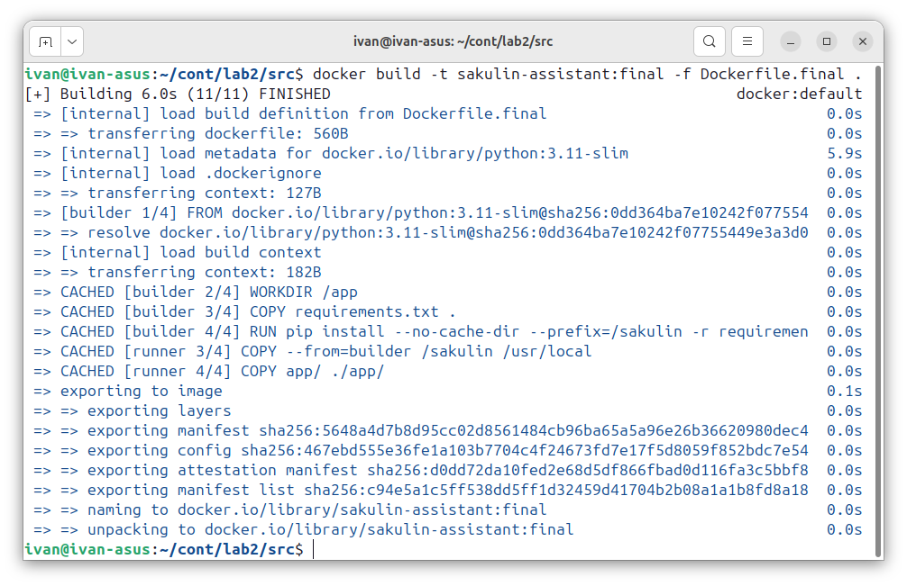

### Задание 4.3 — Проверка статуса здоровья

На рисунке (4-3) видно, что контейнер был запущен и находится в статусе `healtly`.

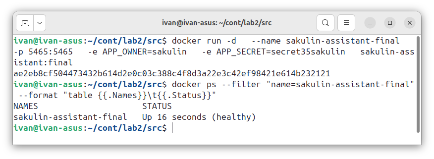

## Этап 5. Финальный артефакт и тегирование

### Задание 5.1 — Добавление семантических тегов

К финальному образу были добавлены два тега: с версией и датой (рисунок (5-1)).

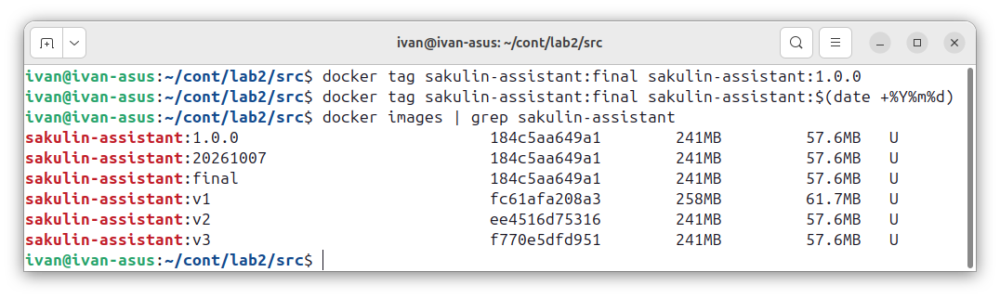

### Задание 5.2 — Артефакт выполнения

На рисунке (5-2) представлен финальный артефакт.

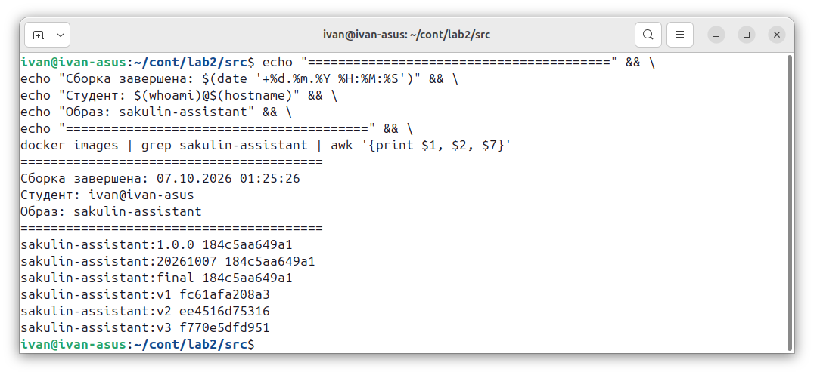
