# Практическая работа №3. Персистентность и изоляция: добавляем БД и настраиваем сети

## Введение

| Параметр                    | Ваше значение   |
| --------------------------- | --------------- |
| Номер ИСУ                   | 467335          |
| Персональный порт assistant | 8035            |
| Персональный порт postgres  | 5465            |
| Персональный префикс        | sakulin         |
| Секретный ключ              | secret35sakulin |
| Имя базы данных             | sakulin35       |

## Этап 1. Запуск контейнера с именованным volume

### Задание 1.1 — Создание именованного volume для БД

На рисунке (1-1) представлено создание volume.

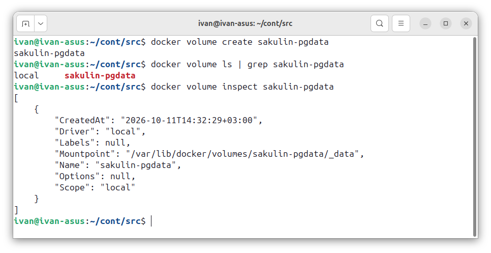

### Задание 1.2 — Запуск PostgreSQL с volume

На рисунке (1-2) представлен запуск контейнера PostgreSQL.

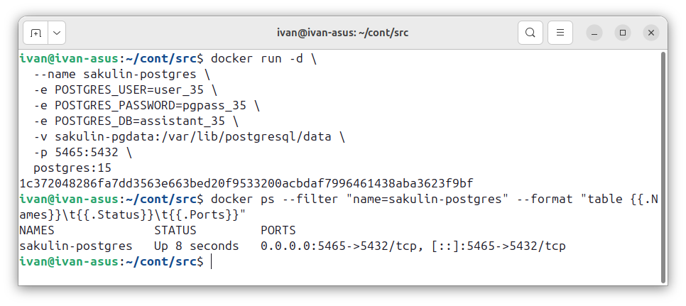

### Задание 1.3 — Сборка образа приложения

На рисунке (1-3) представлена сборка контейнера assistant.

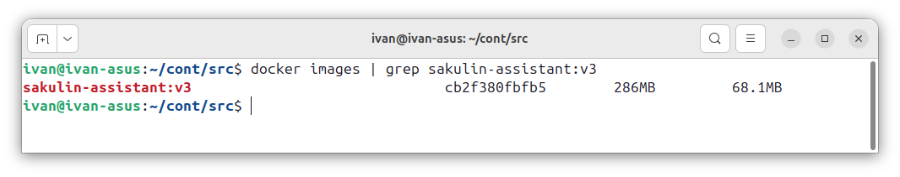

### Задание 1.4 — Запуск ассистента и подключение к БД

На рисунке (1-4) представлен запуск контейнера assistant.

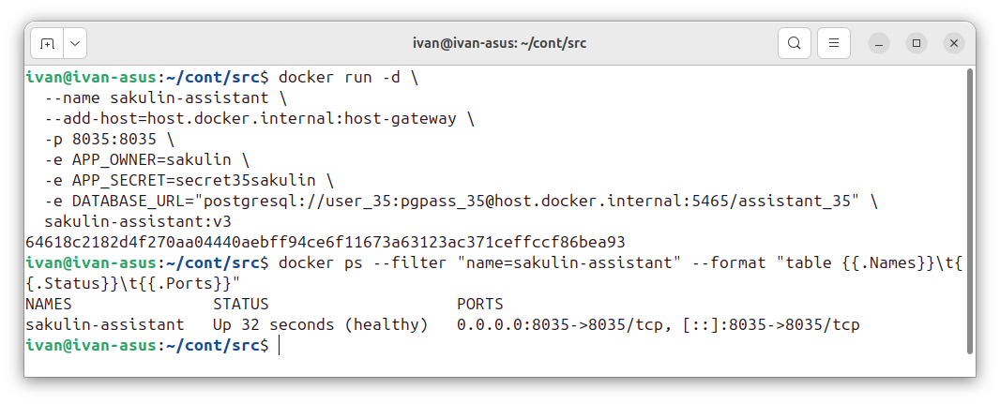

### Задание 1.5 — Проверка работоспособности

На рисунке (1-5) представлена успешная проверка работоспособности сервиса.

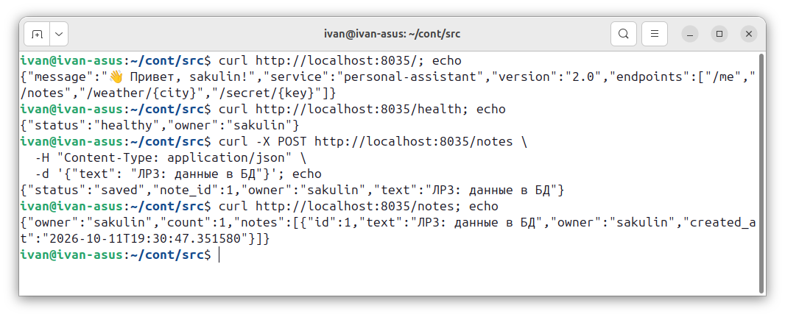

## Этап 2. Тест персистентности: пересоздание контейнера

### Задание 2.1 — Удаление контейнера с ассистентом

На рисунке (2-1) представлено удаление контейнера assistant.

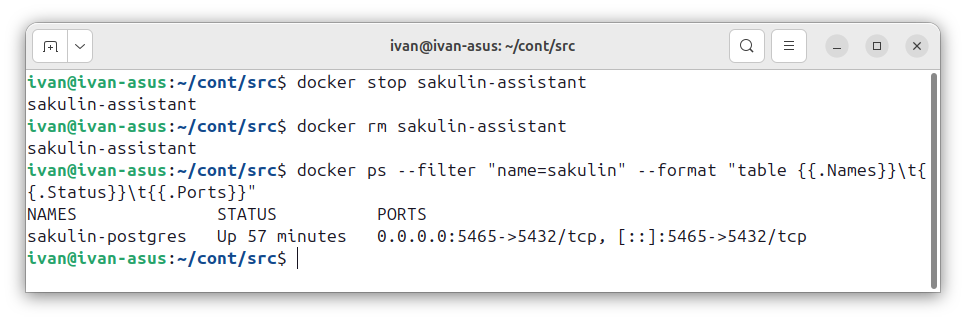

### Задание 2.2 — Перезапуск контейнера ассистента

На рисунке (2-1) представлен повторный запуск контейнера assistant.

### Задание 2.3 — Проверка сохранности данных

На рисунке (2-3) представлен успешный вывод сохраненных заметок.

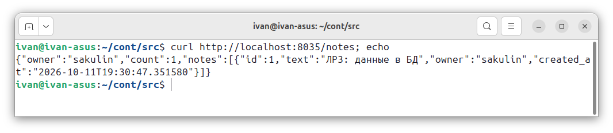

### Задание 2.4 — Артефакт персистентности

На рисунке (2-4) представлен артефакт персистенстности.

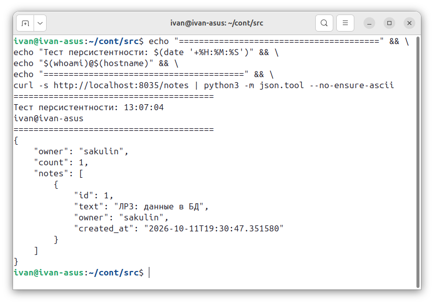

## Этап 3. Bind mount для конфигурации

### Задание 3.1 — Изучение файла конфигурации

На рисунке (3-1) представлен заполненный перональными данными файл конфигурации. Физически он не используется в приложении, поэтому его содержимое полностью демонтрационное.

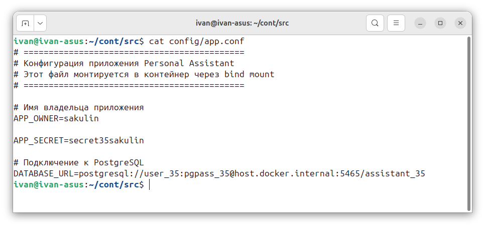

### Задание 3.2 — Создание контейнера с bind mount

На рисунке (3-2) представлен запуск контейнера с подключенным файлом конфигурации.

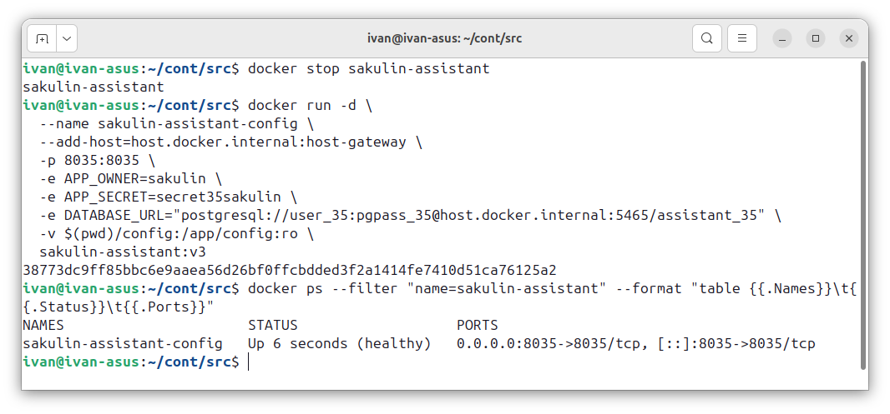

### Задание 3.3 — Проверка доступа к конфигурации

На рисунке (3-3) представлен успешный доступ к конфигурации из контейнера.

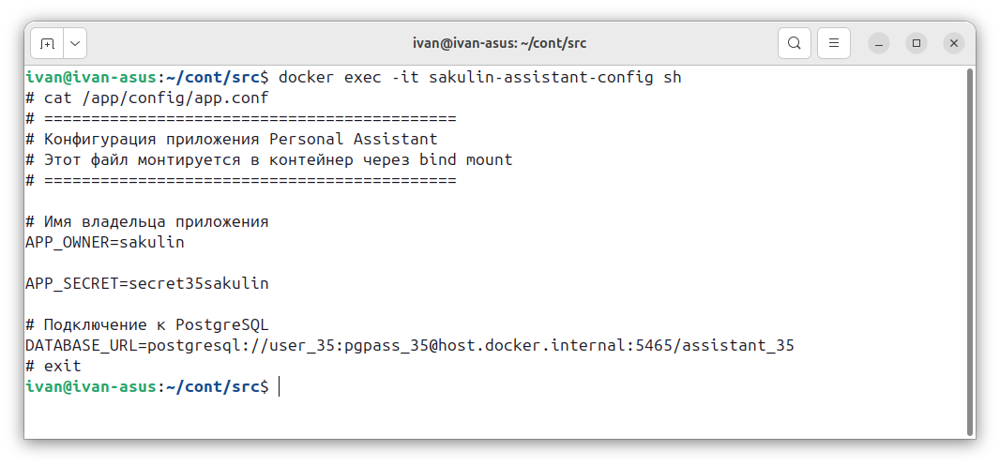

### Микро-челлендж: изменение конфига без пересборки

На рисунке (3-4) показана работа с примонтированной конфигурацией. Смотрим файл с контейнера, измняем его на хостовой машине и снова смотрим с контейнера. Файл меняется даже без `restart`.

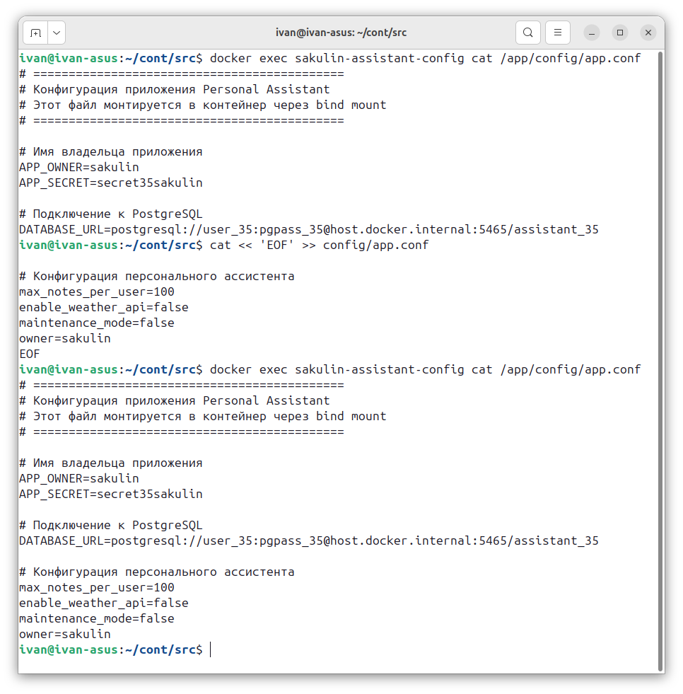

## Этап 4. Пользовательские сети для изоляции

### Задание 4.1 — Создание пользовательской сети

На рисунке (4-1) представлено создание пользовательской сети.

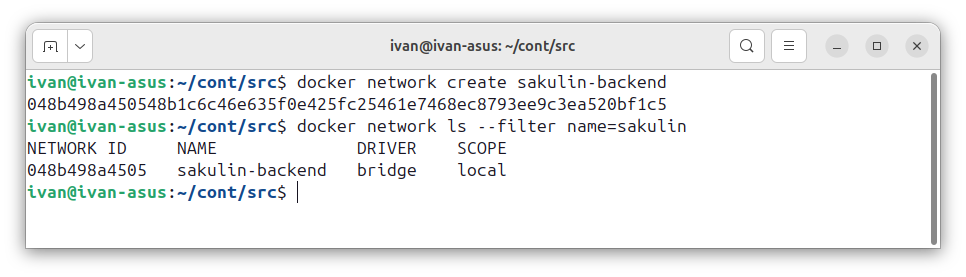

### Задание 4.2 — Пересоздание контейнеров в сети

На рисунке (4-2) представлено пересоздание контейнеров в пользовательской сети.

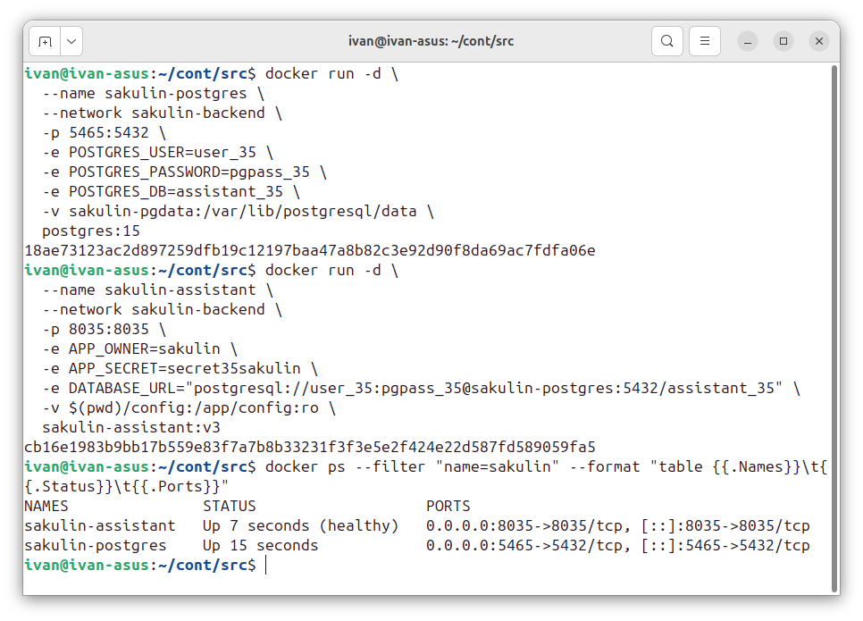

### Задание 4.3 — Проверка связности

На рисунке (4-3) представлена успешная проверка связности контейнеров.

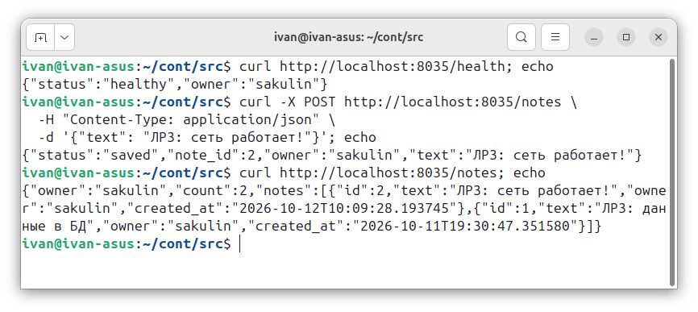

### Задание 4.4 — Исследование сетевой изоляции

На рисунке (4-4) представлен запуск двух временных контейнеров: первый вне сети не смог обратиться к контейнеру в сети, второй внутри сети успешно отправил запросы.

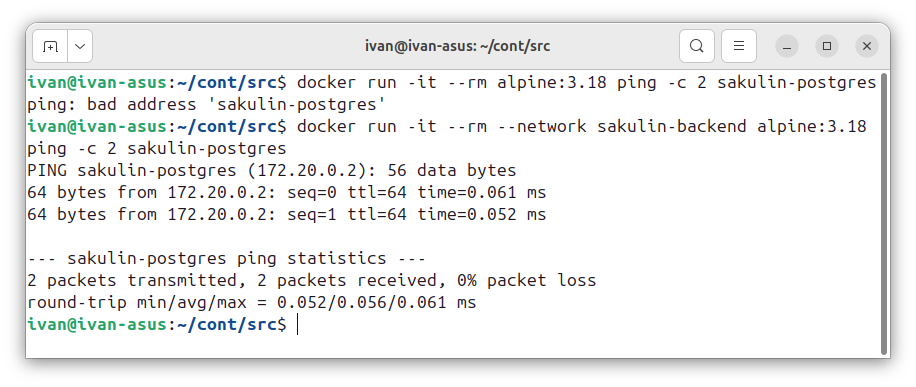

## Финальный артефакт

На рисунке (5-0) представлен финальный артефакт работы.

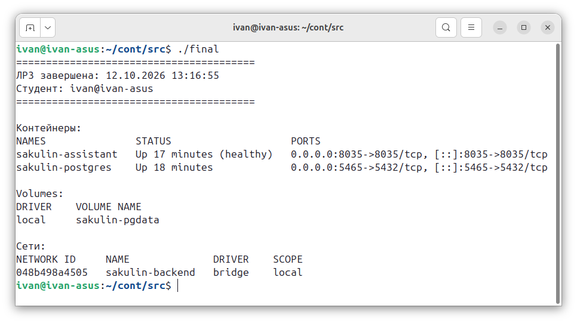
