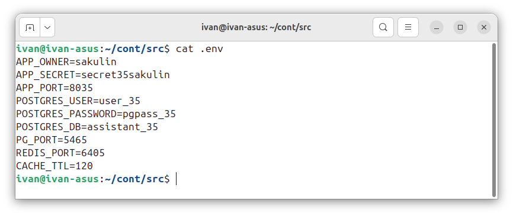
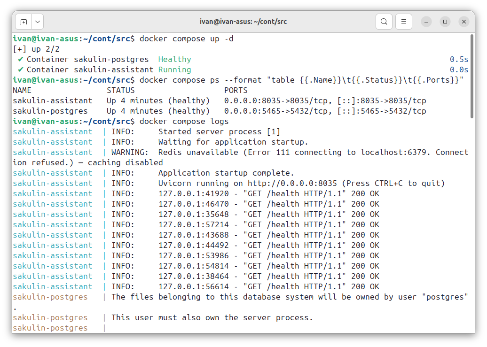
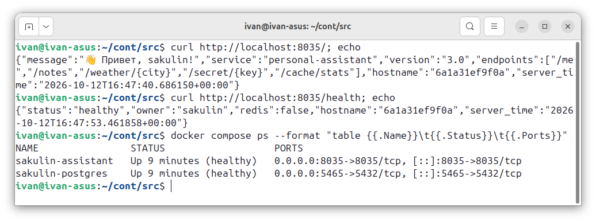
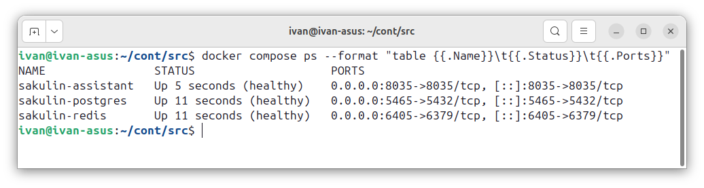
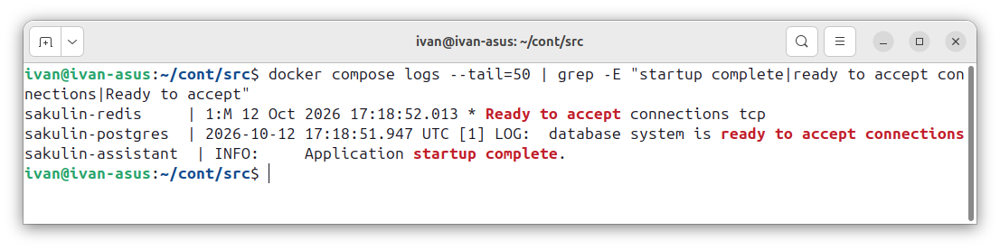
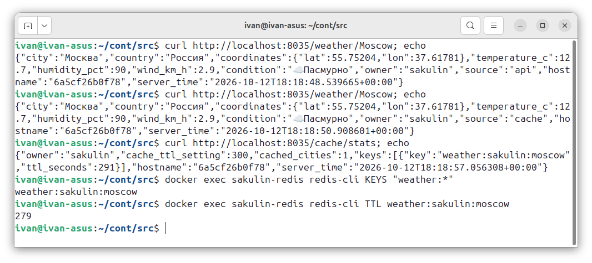
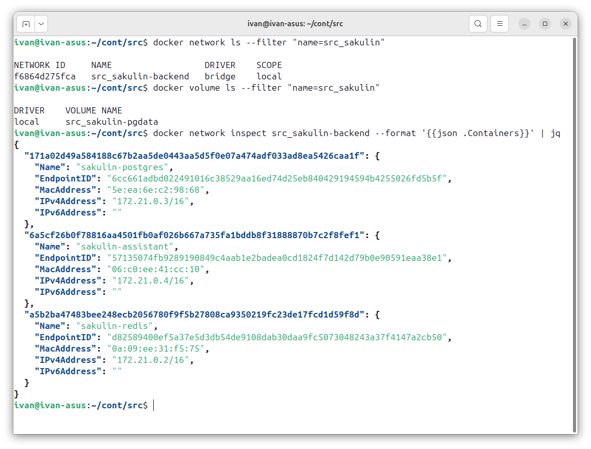
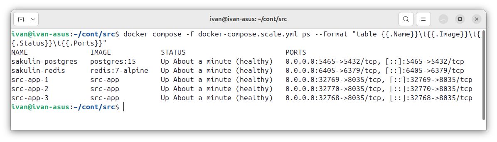
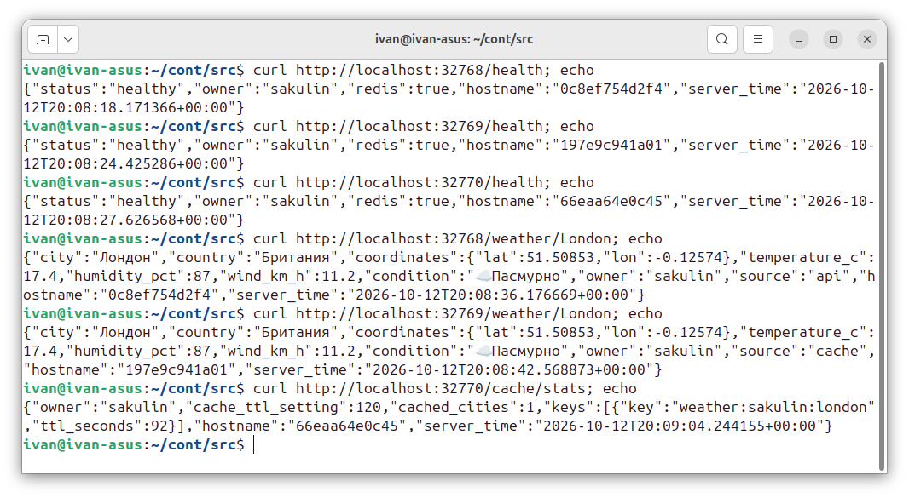
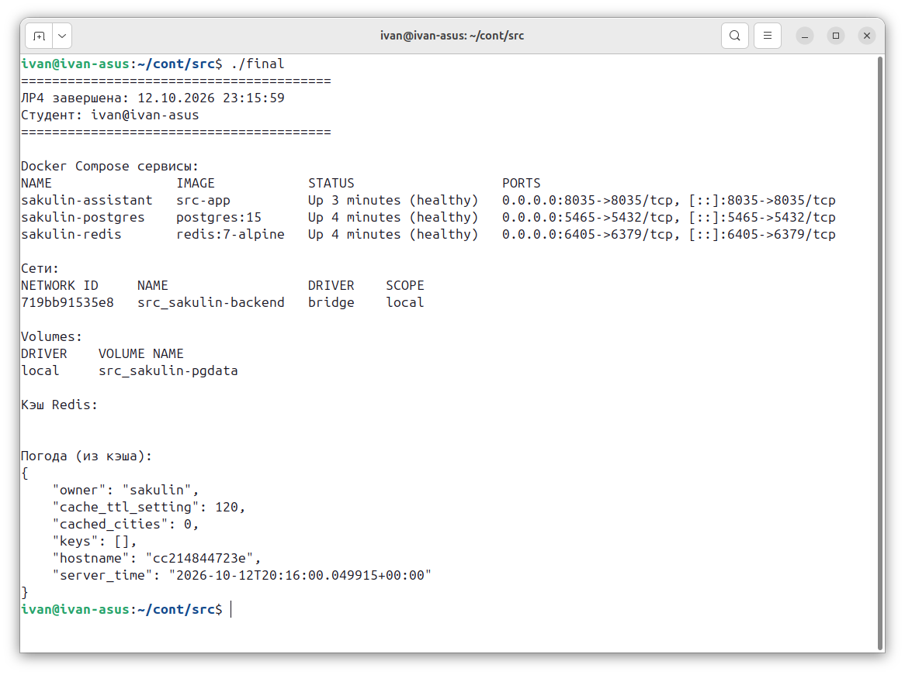

# Практическая работа №4. Docker Compose: оркестрация сервисов с Redis-кэшированием

## Введение

| Параметр                    | Ваше значение   |
| --------------------------- | --------------- |
| Номер ИСУ                   | 467335          |
| Персональный порт assistant | 8035            |
| Персональный порт postgres  | 5465            |
| Персональный порт redis     | 6405            |
| Персональный префикс        | sakulin         |
| Секретный ключ              | secret35sakulin |
| Имя базы данных             | sakulin35       |

## Этап 1. Подготовка проекта для Docker Compose

### Задание 1.1 — Создание файла .env

В корне проекта был создан файл `.env`. Он содержит все персональные переменные, которые docker compose подставит в сервисы автоматически. Его содержисое представлено на рисунке (1-1).



### Задание 1.2 — Создание docker-compose.yml

Был создан файл `docker-compose.yml` в корне проекта. На данном этапе описаны два сервиса: PostgreSQL (db) и приложение (app),использованы переменные из `.env`, связка healthcheck и depends_on, подключены сеть и volumes. Код конфигурации на данном этапе представлена на рисунке (А-1). Результаты запуска контейнеров на рисунке (1-2).



### Задание 1.3 — Проверка базового запуска

На рисунке (1-3) представлена проверка успешного запуска сервисов.



## Этап 2. Добавление Redis для кэширования погоды

Было проверено наличие логики кеширования в приложении, конфигурация была дополнена запуском Redis (рисунок 2-0).
На рисунке (А-2) представлен код полной конфигурации.

```yml
redis:
    image: redis:7-alpine
    container_name: sakulin-redis
    ports:
        - "${REDIS_PORT}:6379"
    networks:
        - sakulin-backend
    healthcheck:
        test: ["CMD", "redis-cli", "ping"]
        interval: 5s
        timeout: 3s
        retries: 5
```

## Этап 3. Запуск и проверка полного стека

### Задание 3.1 — Пересборка и запуск всех сервисов

Все три сервиса были перезапущены, список всех контейнеров представлен на рисунке (3-1).



### Задание 3.2 — Проверка порядка запуска

На рисунке (3-2) представлены отфильтрованые по ключевым словам логи, которые показывают, что assistant запустился только после готовности redis и postgres.



### Задание 3.3 — Проверка работы кэширования

На рисунке (3-3) представлена проверка работы кеширования.



### Задание 3.4 — Исследование networks и volumes

На рисунке (3-4) представлены созданные через compose хранилище и сеть. В сети отображаются все три контейнера сервиса.



## Этап 4. Масштабирование сервиса

### Задание 4.1 — Подготовка сервиса к масштабированию

На рисунке (А-3) представлен код полной конфигурации.

### Задание 4.2 — Запустите масштабирование

На рисунке (4-2) представлен результат запуска compose с масштабированием.



### Задание 4.3 — Проверка масштабированных экземпляров

На рисунке (4-3) представлен результат запросов к сервисам assistant. Кеш у трёх сервисов общий и находится в единственном экземпляром Redis.



### Задание 4.4 — Возврат к основной конфигурации

На рисунке (4-4) возврат к нормальной конфигурации.

## Финальный артефакт

На рисунке (5-0) представлен финальный артефакт работы.



## Приложения

### А-1

```yml
services:
    db:
        image: postgres:15
        container_name: sakulin-postgres
        environment:
            POSTGRES_USER: ${POSTGRES_USER}
            POSTGRES_PASSWORD: ${POSTGRES_PASSWORD}
            POSTGRES_DB: ${POSTGRES_DB}
        volumes:
            - sakulin-pgdata:/var/lib/postgresql/data
        ports:
            - "${POSTGRES_PORT:-5465}:5432"
        networks:
            - sakulin-backend
        healthcheck:
            test:
                [
                    "CMD-SHELL",
                    "pg_isready -U ${POSTGRES_USER} -d ${POSTGRES_DB}",
                ]
            interval: 5s
            timeout: 5s
            retries: 5

    app:
        build: .
        container_name: sakulin-assistant
        environment:
            APP_OWNER: ${APP_OWNER}
            APP_SECRET: ${APP_SECRET}
            POSTGRES_USER: ${POSTGRES_USER}
            POSTGRES_PASSWORD: ${POSTGRES_PASSWORD}
            POSTGRES_DB: ${POSTGRES_DB}
            POSTGRES_HOST: db
            POSTGRES_PORT: 5432
            CACHE_TTL: ${CACHE_TTL}
        volumes:
            - ./config:/app/config:ro
        ports:
            - "${APP_PORT:-8035}:${APP_PORT:-8035}"
        networks:
            - sakulin-backend
        depends_on:
            db:
                condition: service_healthy

volumes:
    sakulin-pgdata:

networks:
    sakulin-backend:
        driver: bridge
```

### A-2

```yml
services:
    db:
        image: postgres:15
        container_name: sakulin-postgres
        environment:
            POSTGRES_USER: ${POSTGRES_USER}
            POSTGRES_PASSWORD: ${POSTGRES_PASSWORD}
            POSTGRES_DB: ${POSTGRES_DB}
        volumes:
            - sakulin-pgdata:/var/lib/postgresql/data
        ports:
            - "${POSTGRES_PORT:-5465}:5432"
        networks:
            - sakulin-backend
        healthcheck:
            test:
                [
                    "CMD-SHELL",
                    "pg_isready -U ${POSTGRES_USER} -d ${POSTGRES_DB}",
                ]
            interval: 5s
            timeout: 5s
            retries: 5

    redis:
        image: redis:7-alpine
        container_name: sakulin-redis
        ports:
            - "${REDIS_PORT}:6379"
        networks:
            - sakulin-backend
        healthcheck:
            test: ["CMD", "redis-cli", "ping"]
            interval: 5s
            timeout: 3s
            retries: 5

    app:
        build: .
        container_name: sakulin-assistant
        environment:
            APP_OWNER: ${APP_OWNER}
            APP_SECRET: ${APP_SECRET}
            POSTGRES_USER: ${POSTGRES_USER}
            POSTGRES_PASSWORD: ${POSTGRES_PASSWORD}
            POSTGRES_DB: ${POSTGRES_DB}
            POSTGRES_HOST: db
            POSTGRES_PORT: 5432
            REDIS_URL: "redis://redis:6379"
            CACHE_TTL: ${CACHE_TTL}
        volumes:
            - ./config:/app/config:ro
        ports:
            - "${APP_PORT:-8035}:${APP_PORT:-8035}"
        networks:
            - sakulin-backend
        depends_on:
            db:
                condition: service_healthy
            redis:
                condition: service_healthy

volumes:
    sakulin-pgdata:

networks:
    sakulin-backend:
        driver: bridge
```

### А-3

```yml
services:
    db:
        image: postgres:15
        container_name: sakulin-postgres
        environment:
            POSTGRES_USER: ${POSTGRES_USER}
            POSTGRES_PASSWORD: ${POSTGRES_PASSWORD}
            POSTGRES_DB: ${POSTGRES_DB}
        volumes:
            - sakulin-pgdata:/var/lib/postgresql/data
        ports:
            - "${POSTGRES_PORT:-5465}:5432"
        networks:
            - sakulin-backend
        healthcheck:
            test:
                [
                    "CMD-SHELL",
                    "pg_isready -U ${POSTGRES_USER} -d ${POSTGRES_DB}",
                ]
            interval: 5s
            timeout: 5s
            retries: 5

    redis:
        image: redis:7-alpine
        container_name: sakulin-redis
        ports:
            - "${REDIS_PORT}:6379"
        networks:
            - sakulin-backend
        healthcheck:
            test: ["CMD", "redis-cli", "ping"]
            interval: 5s
            timeout: 3s
            retries: 5

    app:
        build: .
        environment:
            APP_OWNER: ${APP_OWNER}
            APP_SECRET: ${APP_SECRET}
            POSTGRES_USER: ${POSTGRES_USER}
            POSTGRES_PASSWORD: ${POSTGRES_PASSWORD}
            POSTGRES_DB: ${POSTGRES_DB}
            POSTGRES_HOST: db
            POSTGRES_PORT: 5432
            REDIS_URL: "redis://redis:6379"
            CACHE_TTL: ${CACHE_TTL}
        volumes:
            - ./config:/app/config:ro
        ports:
            - "${APP_PORT:-8035}"
        networks:
            - sakulin-backend
        depends_on:
            db:
                condition: service_healthy
            redis:
                condition: service_healthy

volumes:
    sakulin-pgdata:

networks:
    sakulin-backend:
        driver: bridge
```
