# Практическая работа №5. Введение в Kubernetes: развёртывание приложения с PostgreSQL и Redis

## Введение

Цель работы: р азвернуть приложение из ЛР №4 (FastAPI + PostgreSQL + Redis) в локальном кластере Kubernetes, используя стандартные ресурсы K8s вместо Docker Compose.

| Параметр                    | Ваше значение   |
| --------------------------- | --------------- |
| Номер ИСУ                   | 467335          |
| Персональный префикс        | sakulin         |
| Секретный ключ              | secret35sakulin |
| Имя базы данных             | sakulin35       |
| Персональный порт assistant | 8035            |
| Персональный порт postgres  | 5465            |
| Персональный порт redis     | 6405            |

## Этап 1. Подготовка образа

Все необходимые утилиты были установлены (рисунок 0-0).

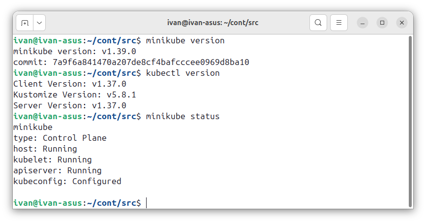

Образ был собран и загружен в minikube (рисунок 1-0).

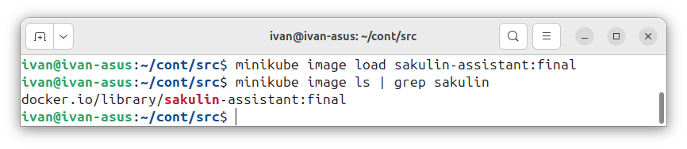

## Этап 2. Развертывание базы данных и кэша

### Персистентное хранилище

Первым делом написан запрос на персистентное хранилище для хранения данных PostgreSQL `postgres-pvc.yaml` (рисунок 2l-pvc).

```yaml
apiVersion: v1
kind: PersistentVolumeClaim
metadata:
  name: sakulin-postgres-pvc
spec:
  accessModes:
    - ReadWriteOnce
  resources:
    requests:
      storage: 1Gi
```

Применим конфигурацию и проверим, что хранилище создано (рисунок 2-pvc).

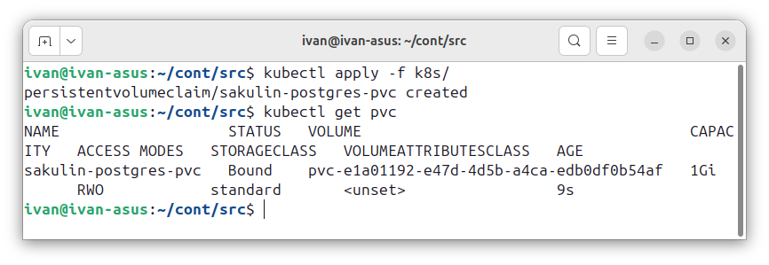

### Cекреты

Создадим файл секретов `app-secret.yaml` (рисунок 2l-secret). Сделаем его копию-пример `app-secret.example.yaml`.

```yaml
apiVersion: v1
kind: Secret
metadata:
  name: sakulin-app-secret
type: Opaque
stringData:
  APP_SECRET: "secret35sakulin"
  POSTGRES_PASSWORD: "pgpass_35"
```

Применим конфигурацию и проверим, что секреты созданы (рисунок 2-secret).

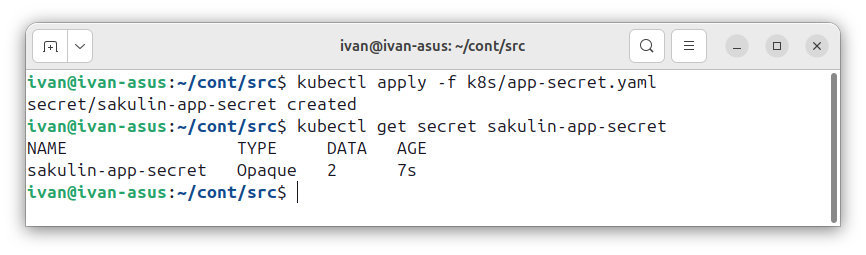

### Конфигурация

Создадим манифест `app-configmap.yaml`, чтобы обозначить k8s, что необходимо держать поднятым один экземплер PostgreSQL (рисунок 2l-config).

```yaml
apiVersion: v1
kind: ConfigMap
metadata:
  name: sakulin-app-config
data:
  APP_OWNER: "sakulin"
  APP_PORT: "8035"
  POSTGRES_USER: "user_35"
  POSTGRES_DB: "assistant_35"
  POSTGRES_HOST: "sakulin-postgres"
  POSTGRES_PORT: "5465"
  REDIS_URL: "redis://sakulin-redis:6405/0"
  REDIS_PORT: "6405"
  CACHE_TTL: "120"
```

Применим и проверим, что файл конфигурации создан (рисунок 2-config).

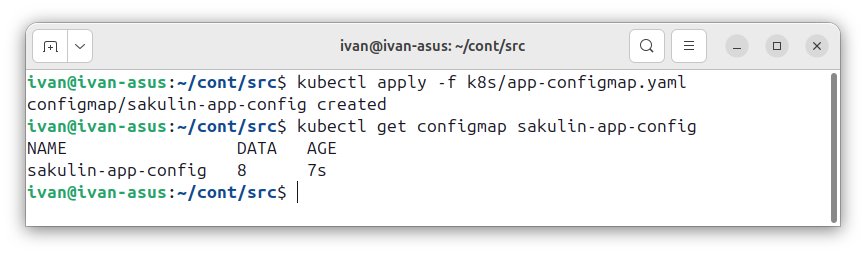

### Создание пода PostgreSQL

Чтобы поднять базу данных, необходимо определить её Deployment (контроллер развёртывания) через `postgres-deployment.yaml` и Service (сетевой сервис) через `postgres-service.yaml`. Pod PostgreSQL успешно создан и запущен, база данных работает (рисунок 2-postgres).

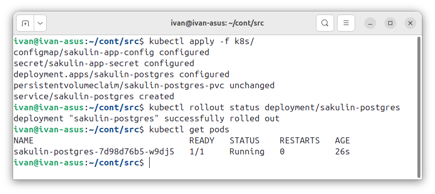

### Создание пода Redis

Чтобы поднять Redis, необходимо также определить его Deployment (контроллер развёртывания) через `redis-deployment.yaml` и Service (сетевой сервис) через `redis-service.yaml`. Pod Redis успешно создан и запущен, база данных работает (рисунок 2-redis).

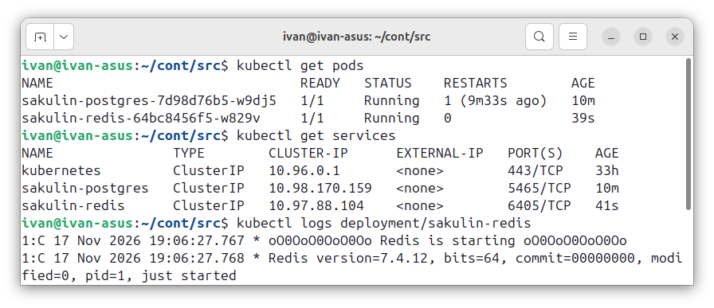

## Этап 3. Развертывание приложения

Для приложения был написан простой Deployment (контроллер развёртывания) через `app-deployment.yaml` (рисунок 3-deployment).

```yaml
apiVersion: apps/v1
kind: Deployment
metadata:
  name: sakulin-app
spec:
  replicas: 1
  selector:
    matchLabels:
      app: sakulin-app
  template:
    metadata:
      labels:
        app: sakulin-app
    spec:
      containers:
        - name: app
          image: sakulin/app:latest
          imagePullPolicy: IfNotPresent
          ports:
            - containerPort: 8035
          env: ...
```

А также Service (сетевой сервис) через `app-service.yaml` (рисунок 3-service).

```yaml
apiVersion: v1
kind: Service
metadata:
  name: sakulin-app-service
spec:
  type: NodePort
  selector:
    app: sakulin-app
  ports:
    - port: 8035
      targetPort: 8035
      protocol: TCP
```

## Этап 4. Проверка

Список всех ресурсов представлен на рисунке (4-all).

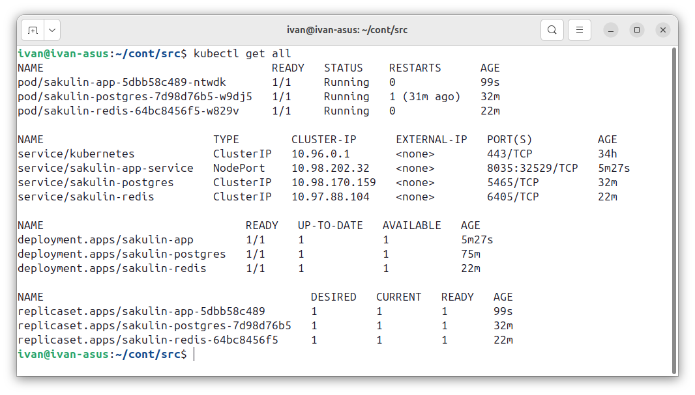

Логи пода приложения представлены на рисунке (4-logs).

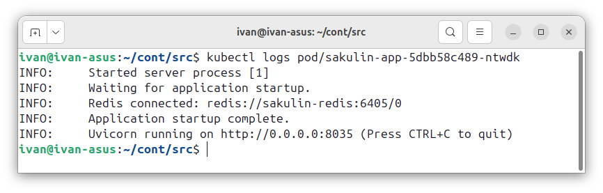

Открытие приложения представлено на рисунке (4-service).

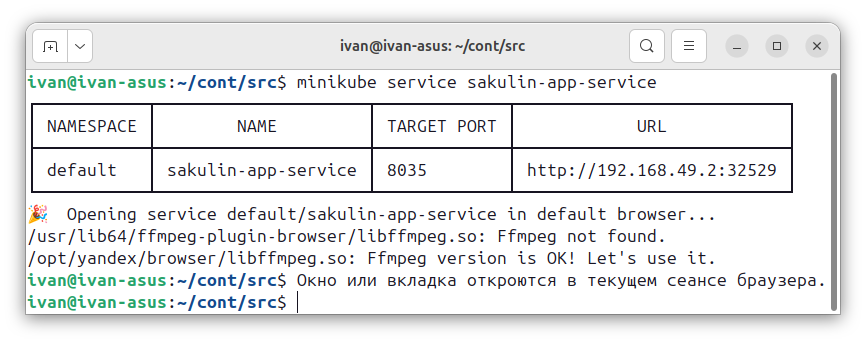

Запросы к API приложения представлены на рисунке (4-api).

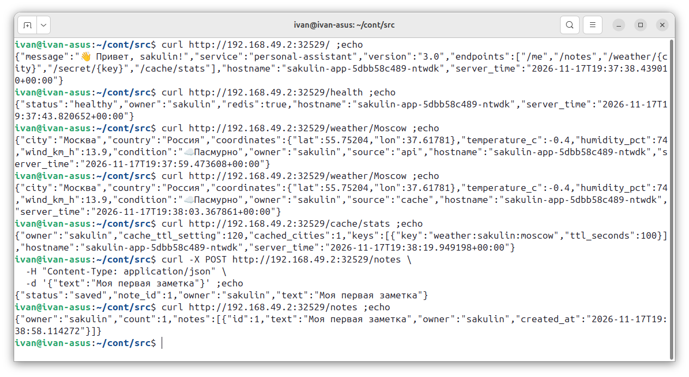

## Этап 5. Пробы работоспособности (readiness и liveness)

Проба `readinessProbe` определяет, готов ли Pod принимать трафик: пока проверка не проходит, Kubernetes не направляет на него запросы через Service.
Проба `livenessProbe` проверяет, что контейнер продолжает работать; при провале проверки Kubernetes перезапускает контейнер.

В `app-deployment.yaml` для контейнера приложения были настроены обе HTTP-пробы на эндпоинт `/health` и порт приложения (рисунок 5-hc).

```yaml
readinessProbe:
  httpGet:
    path: /health
    port: 8035
  initialDelaySeconds: 5
  periodSeconds: 10
livenessProbe:
  httpGet:
    path: /health
    port: 8035
  initialDelaySeconds: 15
  periodSeconds: 20
```

На рисунке (5-0) результат применения манифестов с пробами.

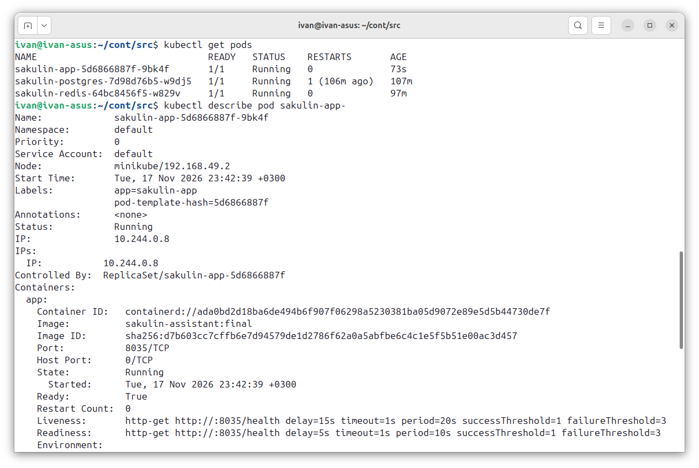

## Ingress

Был создан Ingress на адрес <sakulin.local>, который отправляет трафик на Service приложения, через конфигурацию `app-ingress.yaml` (рисунок 6-ingress).

```yaml
apiVersion: networking.k8s.io/v1
kind: Ingress
metadata:
  name: sakulin-ingress
spec:
  rules:
    - host: sakulin.local
      http:
        paths:
          - path: /
            pathType: Prefix
            backend:
              service:
                name: sakulin-app-service
                port:
                  number: 8035
```

Процесс установки и проверки ingress показан на рисунке (6-0).

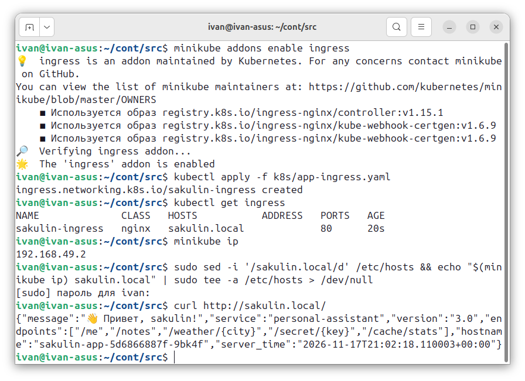
