# Практическая работа №6. Kubernetes на двух машинах и CI/CD: автоматическая сборка образа и выкатка в кластер

## Введение

Цель

1. Собрать кластер k3s из двух машин в одной сети.
2. Настроить в GitHub Actions сборку образа и публикацию в GHCR.
3. Развернуть приложение из ЛР №5 так, чтобы поды были на обоих узлах.
4. Обновить приложение и посмотреть, как проходит rolling update.

| Параметр                    | Ваше значение   |
| --------------------------- | --------------- |
| Номер ИСУ                   | 467335          |
| Персональный префикс        | sakulin         |
| Секретный ключ              | secret35sakulin |
| Имя базы данных             | sakulin35       |
| NodePort приложения         | 30035           |
| Персональный порт assistant | 8035            |
| Персональный порт postgres  | 5465            |
| Персональный порт redis     | 6405            |

## Этап 1. Кластер из двух узлов

В качестве двух узлов была выбрана хостовая машина (master 192.168.56.1) и виртуальная машина (worker 192.168.56.10).

У виртуальной машины для выхода в интернет был настроен сетевой адаптер NAT (рисунок 0-adapter1).

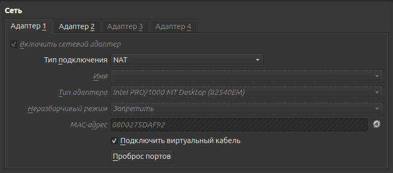

Для связи между master и worker была создана host-only виртуальная сеть без DHCP.

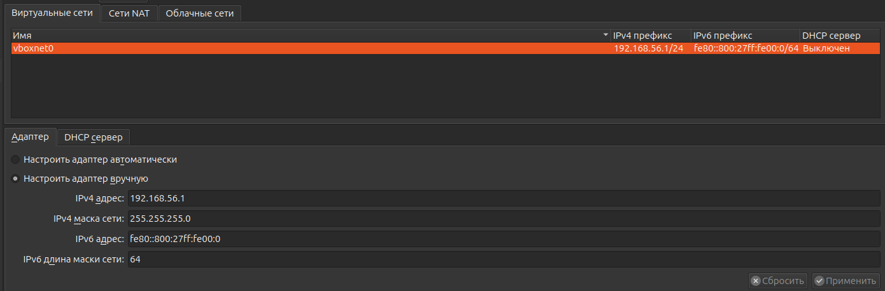

У виртуальной машины настроен второй адаптер и заданы статические адреса (рисунки 0-adapter2 и 0-nmcli).

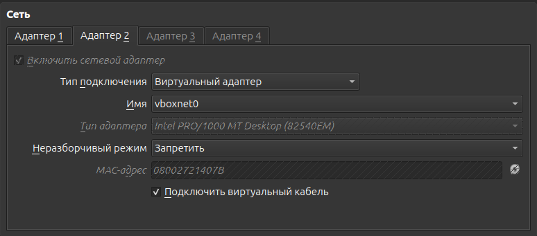

```bash
sudo nmcli con show  # -> "Проводное подключение 1"
sudo nmcli con mod "Проводное подключение 1"   ipv4.method manual   ipv4.addresses 192.168.56.10/24   ipv4.never-default yes
sudo nmcli con down "Проводное подключение 1"
sudo nmcli con up "Проводное подключение 1"
```

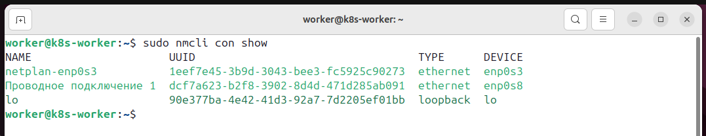

Настройка flannel виртуальной сети на master

```bash
sudo mkdir -p /etc/rancher/k3s && echo 'flannel-iface: vboxnet0' | sudo tee /etc/rancher/k3s/config.yaml
```

Настройка flannel виртуальной сети на worker

```bash
sudo mkdir -p /etc/rancher/k3s && echo 'flannel-iface: enp0s8' | sudo tee /etc/rancher/k3s/config.yaml
```

Проверка связности представлена на рисунках (0-master) и (0-worker).

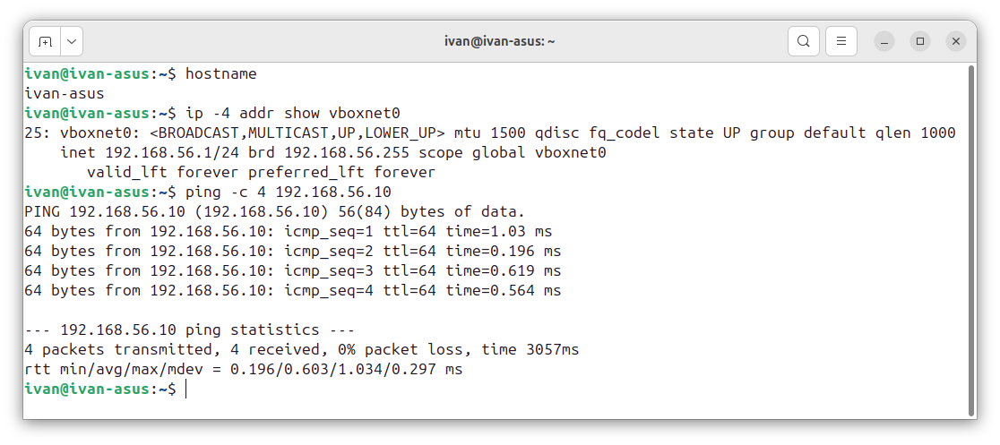

```bash
hostname
ip -4 addr show vboxnet0
ping -c 4 192.168.56.10
```

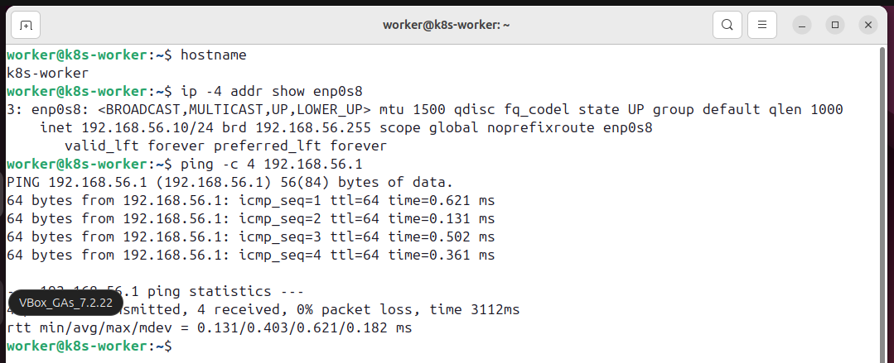

```bash
hostname
ip -4 addr show enp0s8
ping -c 4 192.168.56.1
```

### Задание 1.1 - Установка k3s server на master

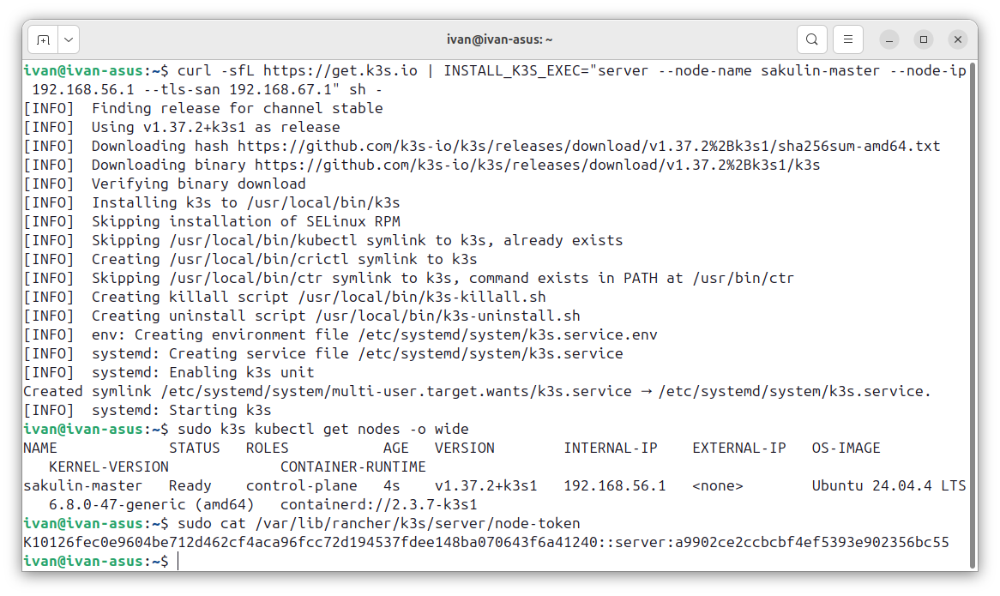

```bash
curl -sfL https://get.k3s.io | INSTALL_K3S_EXEC="server --node-name sakulin-master --node-ip 192.168.56.1 --tls-san 192.168.67.1" sh -
sudo k3s kubectl get nodes -o wide
sudo cat /var/lib/rancher/k3s/server/node-token
```

### Задание 1.2 - Присоединение worker

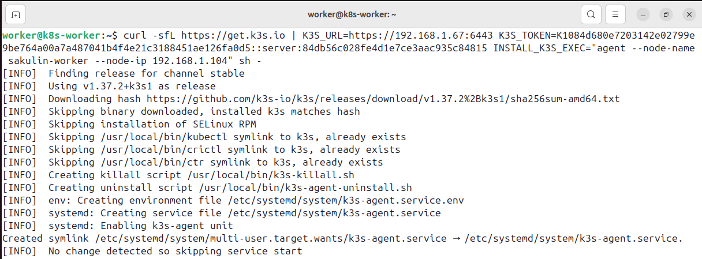

```bash
curl -sfL https://get.k3s.io | K3S_URL=https://192.168.56.1:6443 K3S_TOKEN=K10126fec0e9604be712d462cf4aca96fcc72d194537fdee148ba070643f6a41240::server:a9902ce2ccbcbf4ef5393e902356bc55 INSTALL_K3S_EXEC="agent --node-name sakulin-worker --node-ip 192.168.56.10" sh -
```

### Задание 1.3 - Проверка кластера (на master)

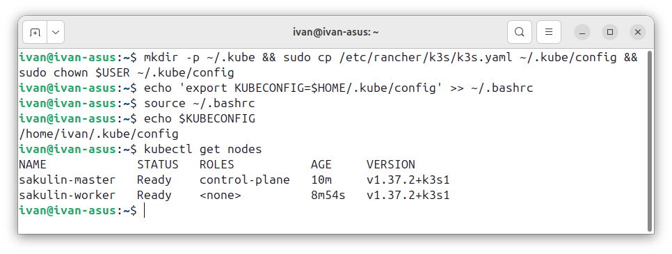

```bash
mkdir -p ~/.kube && sudo cp /etc/rancher/k3s/k3s.yaml ~/.kube/config && sudo chown $USER ~/.kube/config
echo 'export KUBECONFIG=$HOME/.kube/config' >> ~/.bashrc
source ~/.bashrc
echo $KUBECONFIG
kubectl get nodes
```

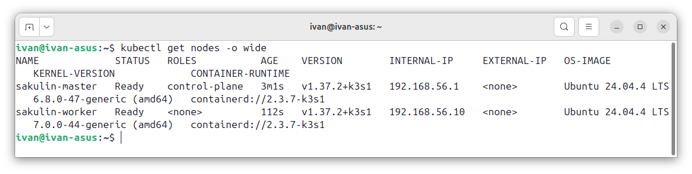

```bash
kubectl get nodes -o wide
```

### Задание 1.4 - Выдача узлам меток

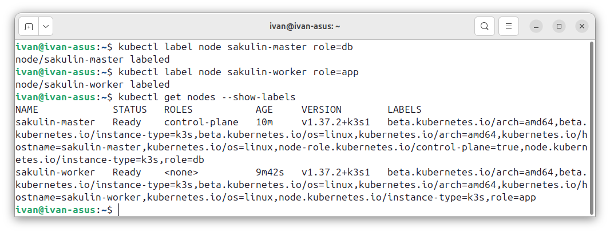

```bash
kubectl label node sakulin-master role=db
kubectl label node sakulin-worker role=app
kubectl get nodes --show-labels
```

### Вопрос про PVC с local-path

Почему PostgreSQL с PersistentVolumeClaim приходится привязывать к одному узлу, если используется storage-класс local-path?

Класс local-path использует локальную файловую систему узла Kubernetes. Поэтому PersistentVolume физически привязан к конкретному узлу через nodeAffinity. Если Pod PostgreSQL перенести на другой узел, он не сможет получить доступ к данным, поскольку они остались на диске первоначального узла. Это ограничивает миграцию Pod и отказоустойчивость Stateful-приложений.

## Этап 2. CI в GitHub Actions

```bash
git add .github/workflows/ci.yml
git commit -m "Added ci workflow"
git push -u origin lab6
```

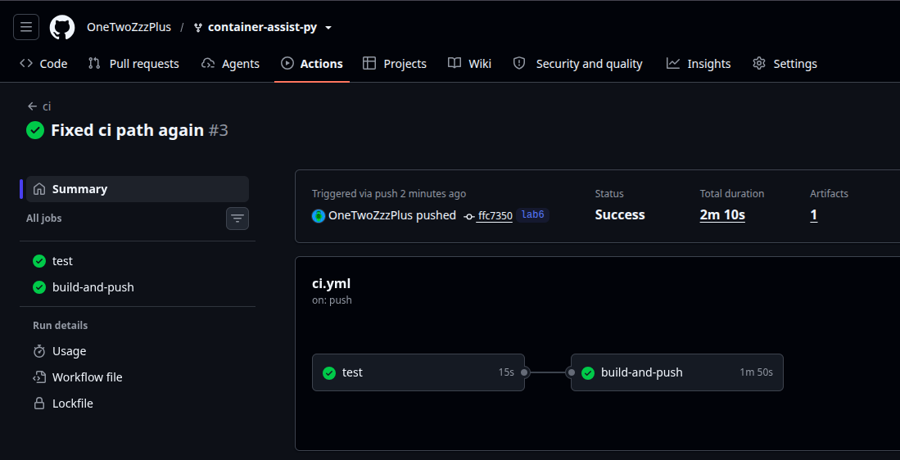

```bash
docker pull ghcr.io/onetwozzzplus/container-assist-py:sha-ffc7350
```

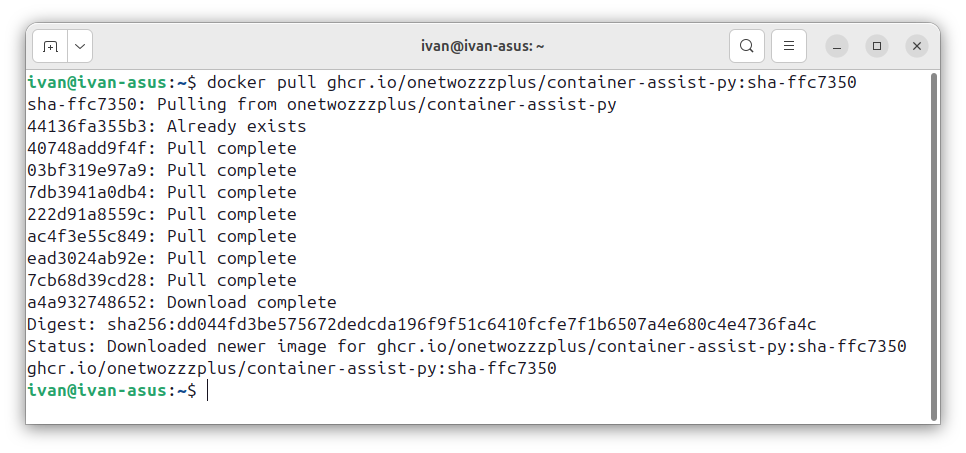

## Этап 3. Развёртывание на двух узлах

### Задание 3.1 - Обновление манифестов

Манифесты были отредактированы согласно заданию: задано размещение базы данных на master, nodePort, количество реплик приложения.

### Задание 3.2 - Применение манифестов

> [!WARNING]
> Тут возникли целых две проблемы. Во-первых, flannel не был четко настроен для работы через интерфейс vboxnet0 - настроена конфигурация flannel интерфейсов. Во-вторых vpn соединение перебивало исходящий с хостовой машины трафик - добавлены direct правила.

```bash
kubectl apply -f k8s/
kubectl get pods -o wide
```

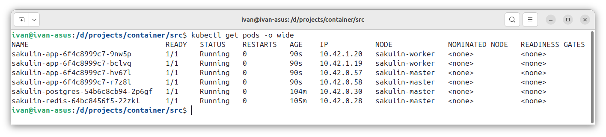

### Задание 3.3 - Проверка доступа с обеих машин

```bash
curl http://192.168.56.1:30035/; echo
curl http://192.168.56.10:30035/; echo
curl http://192.168.56.1:30035/health; echo
```

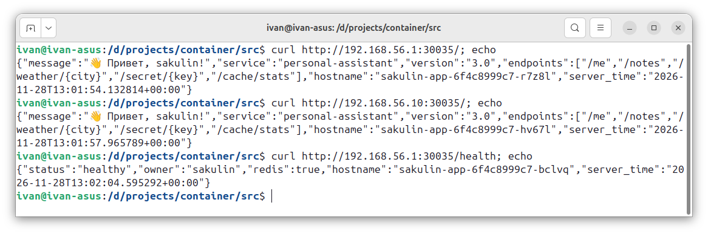

### Задание 3.4 - Проверка балансировки

```bash
for i in $(seq 1 10); do curl -s http://192.168.56.10:30035/ | python3 -c "import sys,json; print(json.load(sys.stdin).get('hostname'))"; done
```

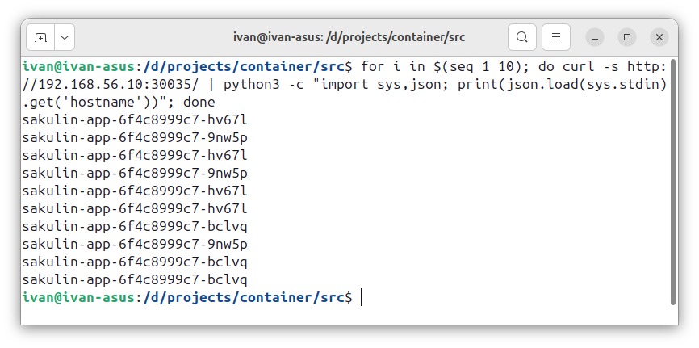

### Задание 3.5 - Проверка кэша и БД

```bash
curl http://192.168.56.1:30035/weather/Moscow; echo
curl http://192.168.56.10:30035/weather/Moscow; echo
curl -X POST http://192.168.56.1:30035/notes -H "Content-Type: application/json" -d '{"text": "ЛР6: кластер из двух узлов"}'; echo
curl http://192.168.56.10:30035/notes; echo
```

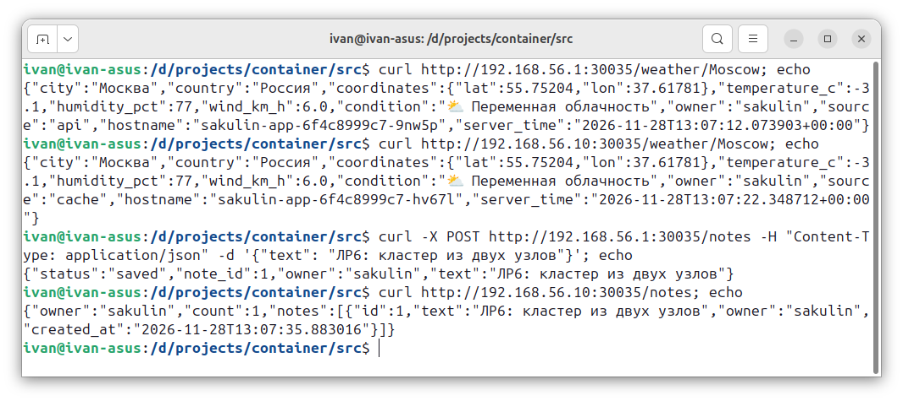

## Этап 4. Простой CD: обновление приложения

### Задание 4.1 - Изменение приложения

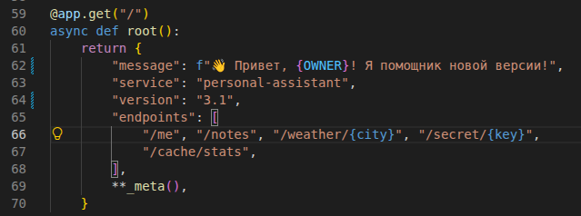

```bash
git add .
git commit -m "Updated app"
git push
```

### Задание 4.2 - Выполнение rolling update

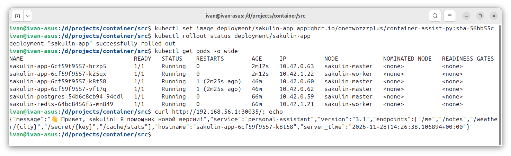

```bash
kubectl set image deployment/sakulin-app app=ghcr.io/onetwozzzplus/container-assist-py:sha-56bb55c
kubectl rollout status deployment/sakulin-app
kubectl get pods -o wide
curl http://192.168.56.1:30035/; echo
```

### Задание 4.3 - Откат

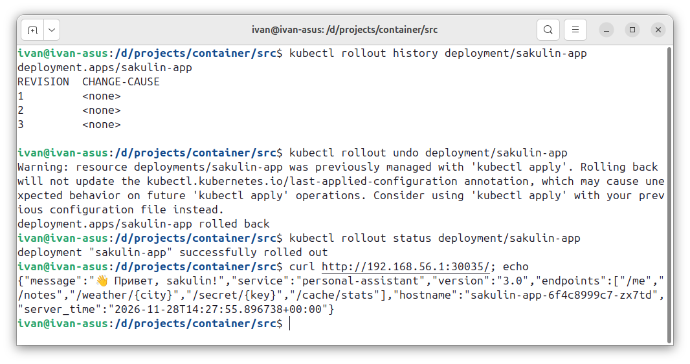

```bash
kubectl rollout history deployment/sakulin-app
kubectl rollout undo deployment/sakulin-app
kubectl rollout status deployment/sakulin-app
curl http://192.168.56.1:30035/; echo
```

### Вопрос про тегирование и latest

Почему в манифесте для production лучше использовать тег с SHA (или digest), а не latest?

Тег latest непредсказуем и мешает rolling update, откату и воспроизводимости, а SHA-тег делает каждый релиз однозначным и отслеживаемым в Git.

### Манифест в Git соответствует кластеру

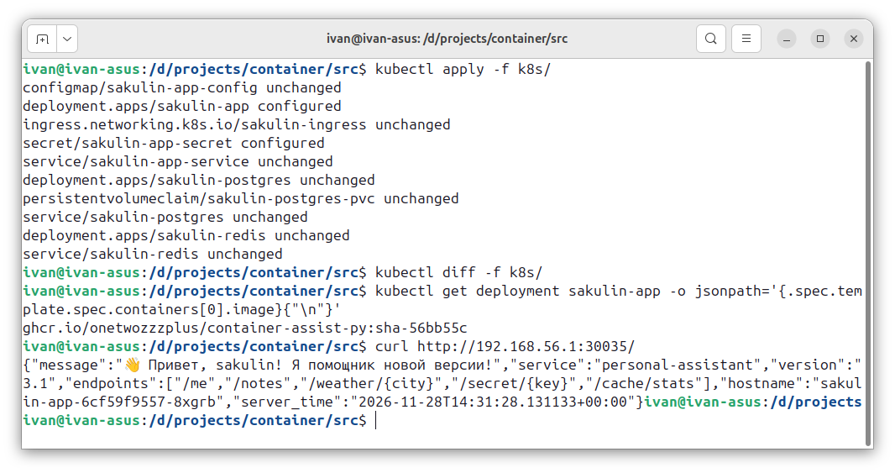

```bash
git add k8s/app-deployment.yaml
git commit -m "Bumped app image to sha-56bb55c"
git push
kubectl apply -f k8s/
kubectl diff -f k8s/
kubectl get deployment sakulin-app -o jsonpath='{.spec.template.spec.containers[0].image}{"\n"}'
```

## Этап 5. Отказоустойчивость и финальный артефакт

### Задание 5.1 - Отключение worker

Спустя 2 минуты после отключения (`sudo systemctl stop k3s-agent`) узел `sakulin-worker` перешёл в статус `NotReady`: master перестал получать от него heartbeat. Поды на worker при этом ещё отображаются как `Running`, так как Kubernetes по умолчанию ждёт 300 секунд (toleration `not-ready`/`unreachable`), прежде чем считать их потерянными. Приложение продолжает отвечать: контейнеры на worker не остановлены, а в NodePort-запросах трафик балансируется на живые поды.

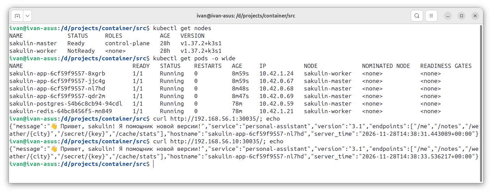

Спустя 5 минут после отключения срок ожидания истёк, узел получил taint `NoExecute`, и поды с worker были выселены. Контроллеры создали их замены на `sakulin-master`, и приложение осталось доступно.

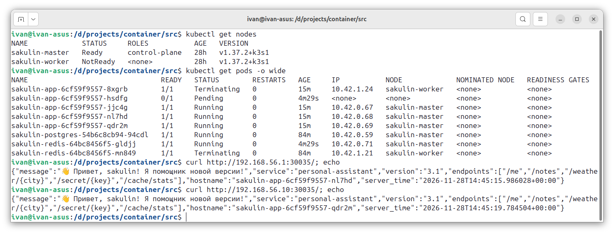

После проверки агент был возвращён командой `sudo systemctl start k3s-agent`.

```bash
kubectl get nodes
kubectl get pods -o wide
curl http://192.168.56.1:30035/; echo
curl http://192.168.56.10:30035/; echo
```

### Задание 5.2 - Финальный артефакт (на master)

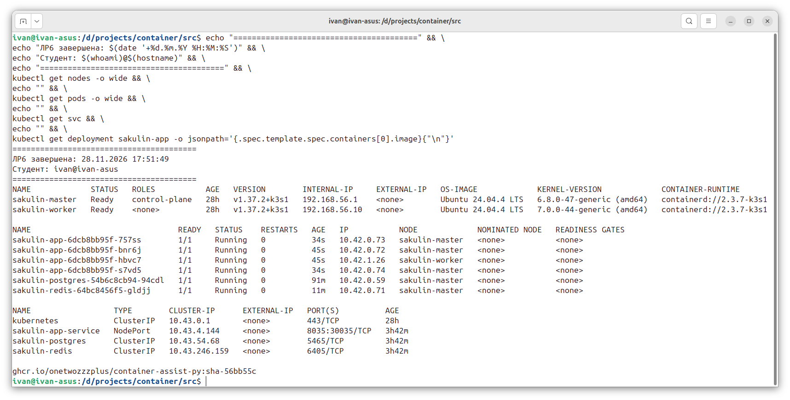

```bash
echo "========================================" && \
echo "ЛР6 завершена: $(date '+%d.%m.%Y %H:%M:%S')" && \
echo "Студент: $(whoami)@$(hostname)" && \
echo "========================================" && \
kubectl get nodes -o wide && \
echo "" && \
kubectl get pods -o wide && \
echo "" && \
kubectl get svc && \
echo "" && \
kubectl get deployment sakulin-app -o jsonpath='{.spec.template.spec.containers[0].image}{"\n"}'
```
